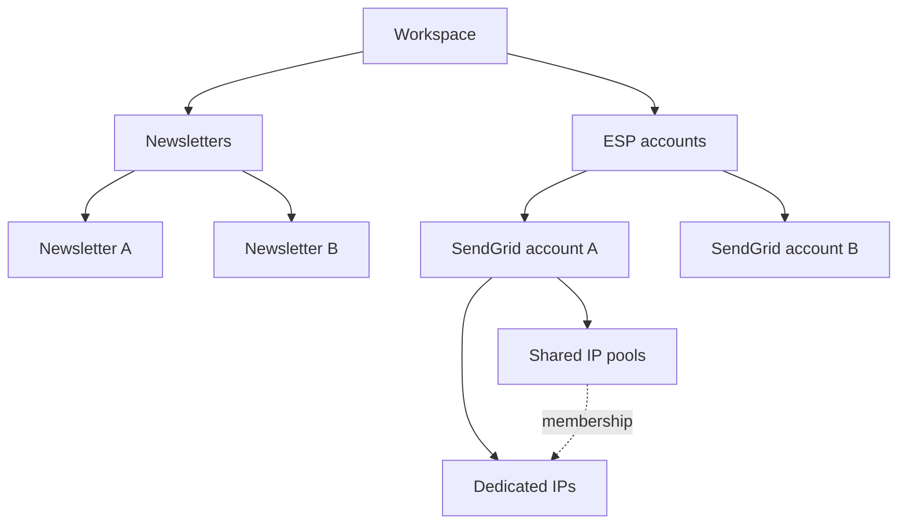

# Ronin Publishing fork: teardown and tracking plan

## Mandate and status

Owner: Carson. This captures his initial product brain dump. Dittofeed is a
stepping stone for our own platform; substantial removal and rebuilding are
intentional. Maintaining upstream feature parity is not a goal. Preserve the MIT
license and required notices; this is not a claim about upstream's maintenance
status.

**Status: initial teardown, native Telnyx replacement, observed `last_clicked` /
`last_opened` per contact/send, owned open-request capture, and opt-in Liquid URL
tokens for recipient/contact values and SHA256/MD5 hashes implemented; Push and
HubSpot UI hiding merged into main.** Human-open qualification and RC-specific receiving integration remain
planned. No existing deployed instance was audited;
local verification is not a production cutover audit. AI implementation rules
live in [AGENTS.md](AGENTS.md); `CLAUDE.md` delegates there.

Newsletter-branded Cloudflare tracking uses one `dt.<newsletter-domain>` hostname
per native newsletter. Carson authorized public provisioning and development-only
deployment using shared target `dt.dittotrx.com` in RONIN and the current server.
Rollout is in progress; email sends and sender workers remain prohibited.

Versioned open-hit heuristics and respond-first queued capture are implemented
locally on `feat/tracking-classifier`. Carson approved a clean development
cutover: every outbound recipient send owns tracking metadata on its existing
NewsletterSend row; all pixel-hit evidence/classifications live in ClickHouse,
with no PG mapping row or PG per-hit receipt/outbox. No mail has shipped and no
old generic-path compatibility is required. `last_opened` remains observed;
heuristic `human` labels never verify that a person read a message. Sender gates stay off.

Carson approved a default-off `ENABLE_OPEN_TRACKING_DEV_LAKE` collection-only
mode, implemented and locally verified on the tracking branch. It records request
and Cloudflare evidence in the dedicated ClickHouse `developmentOpenPixelEvent`
table without native opens, counts, classification, computed-property updates or
automation triggers. Known credentials/cookies and pixel capabilities stay
redacted; encryption, explicit size/unavailable markers, expiry and erasure still
apply. Normal capture remains unchanged with the toggle off. Carson subsequently
authorized live provisioning and development-only capture, never actual sends.

Development-lake verification: 135 targeted Jest tests across six suites and
40 native workerd tests passed. Shared/backend/API/Worker typechecks and the
fresh/restartable migration proof passed. A real local workerd → Queue → signed
HTTP API → ClickHouse fixture retained six GET/repeat/HEAD/unknown/malformed/POST
requests with long headers, nested Cloudflare metadata, repeated query values
and structured body evidence, without normal/native events or send-row changes.
Evidence remained readable after disabling collection. Security coverage includes
sensitive-scope access, TTL, encrypted correlation, partial-write retries and
cross-host erasure races. The focused legacy-lint waiver remains; no new clean
lint claim. All databases were disposable and local; no mail, deployment or
public resource changes occurred.

Authorized live rollout uses RONIN account `2c0f822ce2342b56b3998e7981c03332`,
zone `dittotrx.com` (`a8a65a84a6701e6d9dcc8b617e7b4659`), shared CNAME target
`dt.dittotrx.com`, and existing app origin `https://email.roninpublishing.com`.
Scoped account-owned tokens are stored privately outside the repository. No
ADVERTISE resources, separate hosting or paid upgrade is authorized. Cloudflare
resources are staged disabled pending schema/app readiness; sender workers and
bootstrap remain off. Existing Google/session keys, contacts, database endpoints,
Temporal and logging must be preserved.

Mainline integration preserves historical `0019_newsletter_sender_domain`; the
unshipped tracking migrations are now `0020_send_open_tracking` and
`0021_development_pixel_erasure`, with unchanged SQL bytes/hashes. Fresh/restartable
journal and empty-only teardown proofs passed. Production's three obsolete
tracking tables and all send/infrastructure inventories were verified empty;
private PostgreSQL/runtime backups and a read-only ClickHouse history archive
were verified before schema execution was authorized.

Live source inspection found Mimecast DoH requires exact `application/dns-json`
and Apple's current official CSV is 12,052,078 bytes. The refresh now sends that
Accept value and permits a bounded 16 MiB Apple source (other sources retain
5 MiB); native regressions prove negotiation, large-source acceptance and
oversize preservation of the previous set. The shared CNAME service host is
excluded from capture, preventing unowned root requests from poisoning batches
of real newsletter observations.

Google OIDC and application-owned accounts, explicit workspace memberships,
roles, private invitations, and revocable sessions are implemented. The local
preview now uses a dedicated **DITTO Email Client** Google project under Ronin;
Pepper's OAuth app is unchanged. Real branded owner sign-in, RONIN Admin access,
account/team screens, workspace switching, current-session revocation and fresh
login are verified. One-time bootstrap settings remain removed.
Carson selected External audience and local Testing mode; the owner is its only
configured Google test user. Real second-account acceptance, public homepage/
privacy URLs, production consent publication and origin/deployment remain release
gates. The integration checkpoints migrations `0000`–`0017`. See
[account operations](packages/docs/guide/google-sso.mdx) and
[the setup handoff](GOOGLE_SSO_HANDOFF.md).

## Product decisions

| Area | Decision | Boundary |
| --- | --- | --- |
| SMS | Remove everything, including Twilio and SignalWire. | Hermes owns SMS. No replacement SMS implementation here. |
| Push Notifications | Keep the implementation; hide it from the UI. | Low likelihood of future use, roughly 5–10%; do not delete its backend. |
| Settings → Data Sources → Segment.io | Remove the integration entirely. | Remove both source and destination integration wiring, not audience segmentation. |
| Contact and event registry | Keep an independent database and contact registry. | Preserve direct ingestion and existing contact/history data; do not merge into another system. |
| RP Edge enrichment | Possible future data-source integration. | Undecided; do not build or assume its contract yet. |
| Settings → Message Channels → Postmark | Remove entirely. | Include sender, webhook, configuration, UI, and dependencies. |
| Settings → Message Channels → Mailchimp | Remove entirely. | Include sender, webhook, configuration, UI, and dependencies. |
| Resend → Telnyx email | Remove Resend; implement Telnyx email. | Use Resend as a code-pattern reference, not a protocol or compatibility shim. Telnyx SMS is out of scope. |
| HubSpot | Keep the integration; hide it from the UI. | Low likelihood of future use, roughly 5–10%; preserve backend/workflows. |
| Other inherited features/providers | No removal decision yet. | Do not expand the teardown beyond the decisions above. |
| Sending operations | Not authorized during infrastructure preparation. | No email deliveries, test sends, campaigns, or provider-account changes; validate tracking with inbound HTTP fixtures. |
| Public tracking infrastructure | Separate `dt.<newsletter-domain>` per native newsletter behind a shared Cloudflare Worker and SaaS CNAME/TLS. Shared target `dt.dittotrx.com`; backend is the current `https://email.roninpublishing.com` server and existing databases. | Carson authorized provisioning and development-only capture in RONIN account `2c0f822ce2342b56b3998e7981c03332`; no ADVERTISE resources, separate hosting, paid upgrades, sends or sender-worker re-enablement. |

## Implementation order and acceptance

### 1. Initial teardown: establish the starting point

- [x] Remove all SMS: provider adapters, send execution, templates/editors/previews,
  journey/channel choices, settings, APIs, shared types/events, configuration,
  dependencies, seeds/fixtures, examples, and relevant product docs.
- [x] Remove Segment.io source and destination integrations. Preserve native
  identify/track/batch ingestion, contact registry, segments, and segmentation UI.
- [x] Remove Postmark and Mailchimp end to end.
- [x] Replace Resend with Telnyx email end to end: credentials/settings, sender,
  provider selection, send-result identity, verified webhook processing, event
  normalization, examples/docs, and targeted verification. Resend code, SDK,
  types, webhook routes, and active credential handling are removed; historical
  rows remain preserved.
- [x] Hide Push Notifications everywhere users can select, create, configure, or
  navigate to them, including direct UI routes; retain backend functionality.
- [x] Hide HubSpot configuration, onboarding, and other UI entry points, including
  direct UI routes; retain integration code and workers.
- [x] Keep the separate contact/event database and direct ingestion functional.

Before removing handlers or schemas, inspect saved templates, journeys, provider
configuration, historical events, and running Temporal workflows. Define explicit
migration/rejection behavior for removed feature resources so workflows do not
silently break. Do not delete contact/event history or old database migrations.
Hiding retained UI is not authorization and must not accidentally disable its
backend. Verify the actual dashboard surfaces and remaining email/ingestion paths.

#### SMS cutover and verification

Removed SMS sending/provisioning, Twilio/SignalWire adapters and SDKs, public and
admin provider settings endpoints, Twilio SMS callbacks, shared channel/provider
types, editor routes, selectors, seeds/fixtures, product docs, and obsolete
screenshots. Existing email, Push, Webhook, HubSpot, native ingestion, phone
contact traits, and audience segmentation remain in scope. SendGrid's
`x-twilio-email-event-webhook-*` headers remain because they authenticate email
events, not SMS.

Legacy saved SMS definitions are excluded from active template/journey
collections with warnings; legacy workflow definitions fail explicitly rather
than being treated as email. No contact/event records or historical migrations
were deleted. Physical historical SMS provider tables and the old database enum
value remain in existing databases; active Drizzle exports no longer expose
them. Do not generate/apply destructive cleanup migrations from that schema
difference.

Before replacing API/worker code on an existing deployment:

```bash
# Requires DATABASE_URL and TEMPORAL_ADDRESS; TEMPORAL_NAMESPACE is optional.
# Temporal Cloud additionally requires TEMPORAL_API_KEY (TLS/namespace metadata).
yarn workspace backend-lib sms-cutover-preflight
```

The script performs read-only saved-resource and running-workflow inspection,
logging identifiers rather than bodies/secrets. Exit 0 means no legacy SMS
resources/workflow inputs were found; 1 means findings; 2 means inspection was
incomplete. Resolve findings and drain/cancel affected running workflows using
the existing deployment before replacing workers; do not bypass the preflight
or delete contact/event history. No automated destructive migration or workflow
cancellation is included.

Local proof:

- TypeScript checks passed for isomorphic-lib, backend-lib, API, dashboard, and
  admin-cli after building the required emailo exports.
- 24 runtime schema scenarios passed: SMS rejected for templates/test sends/
  batch sends/journeys/broadcasts; retained channels and native identify/track/
  batch ingestion remain valid, including phone traits and historical event names.
- 11 real Fastify requests passed: removed SMS settings/callback endpoints return
  404; retired template payloads return 400; native ingestion and SendGrid email
  verification continue to require their authentication headers.
- Three isolated API regressions passed for retired template create/reset/test
  requests. Invalid create/reset requests now serialize as 400 instead of 500.
- The removed `/dashboard/templates/sms/removed` route visibly returned 404 in
  a local Next.js browser session.
- Preflight returned exit 2 with both database and Temporal inspection incomplete,
  as required without deployment configuration. No live send, database-backed
  integration test, or Temporal workflow regression was run; those require the
  deployment services. Settings/other authenticated screens were not visually
  exercised against a live workspace.

#### Segment.io removal and native data boundary

Removed the signed `/api/webhooks/segment` and `/api/public/webhooks/segment`
endpoints, GET/PUT/DELETE `/api/settings/data-sources` and admin equivalents,
Segment-only configuration contracts and active Drizzle relations, Settings
navigation/card/state, SDK scripts, sample event generator, obsolete integration
fixtures, SDK dependencies, docs/OpenAPI paths, and Segment-only screenshots.
The destination integration was only advertised as “Coming Soon”; that product
entry was removed rather than replaced with a new outbound integration.

Preserved native `/api/public/apps/{identify,track,batch,page,screen,group}`,
workspace write keys, contact/user-property APIs and tables, ClickHouse event
history, discovery of event/trait names, audience segment APIs/editors, computed
properties, manual segments, journeys, and broadcasts. Generic phone traits and
manual-segment ingestion metadata remain. Existing event/trait tests now use
native identify events rather than the removed Segment sample generator.

Historical `SegmentIOConfiguration` tables/rows and migration snapshots remain
untouched; no destructive schema migration is included. Do not generate/apply
automatic table-drop migrations from the narrowed active Drizzle schema. Before
upgrading an existing deployment, inventory configured Segment webhook
destinations and redirect/disable upstream delivery deliberately: removed
endpoints now return 404 and no longer accept upstream events. No Segment-owned
workflow implementation was found in the source; ordinary segment/journey/
computed-property workflows are independent and remain.

Fresh local infrastructure and its workspace are separate from any existing
deployment. Inspecting that empty configuration does not certify a production
cutover. Do not print historical shared secrets while inventorying configuration.

Local removal proof: five affected packages type-check after a clean rebuild;
18 real HTTP requests against the local API confirm removed Segment webhook/
settings endpoints return 404 while native ingestion/contact/event/property/
segment endpoints retain validation. Native batch normalization preserves
identify/track identities, event times, traits (including phone), properties,
and context. Generated OpenAPI/docs JSON is valid and retains registry and
audience segment APIs without Segment.io paths/contracts.

The historical configuration table is preserved, not used as an active
integration. Old Segment write keys/shared secrets do not authorize native
ingestion; upstream producers must deliberately adopt native workspace write
keys and endpoints before cutover.

Additional data-path proof: 13 audience-segment tests passed against isolated
Postgres/ClickHouse test databases; all 10 native event/trait registry tests
passed in a separate Jest process. The initial combined in-band run hit a
closed-pool teardown error in its second suite; no registry assertions were
removed or weakened. The isolated test databases were distinct from the preview
workspace.

#### Postmark and Mailchimp/Mandrill removal

Removed both provider send adapters and provider-only tests, webhook routes
under both `/api/webhooks` and `/api/public/webhooks`, signature/authentication
helpers, SDKs/typings, provider/secret/success/failure schema variants and mappings,
Settings forms/options, broadcast overrides, analytics choices, docs/OpenAPI
contracts, and obsolete screenshots. Resend remains until the Telnyx cutover;
SendGrid, SES, SMTP, Test, Gmail, shared email/unsubscribe handling, and native
contact/event/segmentation functionality remain.

The supported provider catalog is now the provisioning source of truth.
Historical provider rows are excluded from listings without loading their
credentials or recreating removed providers. Unsupported saved defaults/overrides
fail explicitly; an invalid local default must not silently fall back to a parent.
The default-provider API rejects historical IDs and names for removed providers,
and the UI shows an unavailable selection rather than substituting a supported
provider. Full journey validation rejects unsupported definitions before earlier
email nodes can send.

Read-only local inventory before removal found one unconfigured row for each
provider, no removed-provider defaults, no saved journey/template/broadcast
references, and no removed-provider references in the two running workflows
inspected. Historical provider/secret rows, raw contact/event data, and migrations
were not deleted. This is local preview evidence only.

Before upgrading an existing deployment, inventory configured providers/defaults,
saved provider overrides, upstream callbacks, and in-flight workflows. Explicitly
reconfigure affected defaults and retire/drain affected resources/workflows before
replacing handlers. Removed callbacks return 404. The SMS-specific preflight is
not an email-provider audit; no production migration or credential deletion was
performed here.

Verification: affected TypeScript packages and the combined Lite server build
passed. Isolated suites passed 26 messaging tests, 2 provider-catalog/update tests,
4 Temporal journey tests, and 5 default-provider API tests (37 total), including
retired defaults/overrides, history preservation, and no sends before invalid
journey definitions fail. Blob storage was disabled; no external email-provider
delivery was attempted. Thirteen live HTTP requests verified removed callbacks/
configuration/test-send requests are rejected while retained webhooks and native
ingestion still validate. The current authenticated Settings page offers
SendGrid, Amazon SES, Telnyx, SMTP, and Test, with no retired forms/options.

#### Working local preview

The fresh local workspace is available at `http://localhost:3000/dashboard`.
Its password and generated session/database credentials live in ignored `.env`;
do not commit or log them. No production credentials or existing deployment
data were imported. The preview starts empty rather than presenting seeded
contacts or segments as real data.

Use the repository's existing **Lite** server for single-tenant development:
it serves API and dashboard on the same origin and forwards verified session
state to Next.js. A standalone Next server plus a separate API login origin can
return login success without establishing a usable dashboard session. Verified
in a real browser: login succeeds, authenticated Settings survives reload,
Segment.io/Data Sources navigation is absent, and Users and audience Segments
pages render. No authentication bypass or cookie/state injection was used.

This is loopback-only HTTP. The insecure-cookie banner remains informational;
do not set `SESSION_COOKIE_SECURE=true` unless the preview is actually served
over TLS. No warning was hidden and no CA trust settings were changed.

Runtime state is isolated under
`$HOME/.local/share/dittofeed-preview/runtime`: native Colima/Lima, Docker client,
and Compose, with a 4-CPU/8-GB/30-GB VM named `dittofeed`. Postgres, ClickHouse,
and Temporal use the repository's Lite Compose services, with
`.tmp/local-preview-compose.yaml` overriding ports/healthchecks so exposed
services bind only to loopback. Persistent volumes use project `ronin-preview`.

Restart infrastructure from the repository root:

```bash
R="$HOME/.local/share/dittofeed-preview/runtime"
export PATH="$R/bin:$PATH"
export DOCKER_CONFIG="$R/docker-config"
export COLIMA_HOME="$R/colima"
colima start --profile dittofeed
docker compose --env-file .env -p ronin-preview \
  -f docker-compose.lite.yaml -f .tmp/local-preview-compose.yaml \
  up -d --wait postgres clickhouse-server temporal
```

Then run the existing combined source server:

```bash
node .yarn/releases/yarn-4.1.1.cjs workspace lite dev
```

Dashboard hot reload is active. Rebuild affected TypeScript packages and restart
Lite after backend/worker changes because their workspace exports use compiled
output. The worker reached `RUNNING`; the inherited Temporal image reports that
SDK worker heartbeats are unsupported, but this did not block startup. To stop
the VM without deleting preview data, use `colima stop --profile dittofeed`.

### 2. First post-teardown feature: `last_clicked`

- [x] Provide a contact-level `last_clicked` property and per-send click history
  with workspace, stable contact ID, internal send/message ID, provider message
  ID, link identity/destination, and event identity. A contact aggregate alone is
  insufficient for per-send attribution.
- [x] Make the property available wherever contacts are queried, segmented, and
  used to personalize messages. Reuse existing computed-property machinery if it
  meets the update and retrieval requirements; avoid a second contact store.
- [x] Add opt-in downstream URL attribution using explicit Liquid tokens such as
  `?subscriber_email={{subscriber_email}}`, other contact fields, and SHA256/MD5
  hashes. Never append or overwrite attribution automatically. Preserve literal
  URLs, contact/send IDs, and provider correlation. RC-specific receiving APIs
  are not part of this generic URL contract.
- [x] Capture available native click evidence from rollout; expose observations
  explicitly as unqualified, including provider/event/send identifiers and URLs.
- [ ] Classify suspected bots versus qualified human engagement. Scanner clicks
  currently count toward `last_clicked`; no timing heuristic establishes humanity.

Timestamp contract: maximum observed UTC click event time across sends for the
contact; each send retains its own timestamp/count/history. Retry deduplication
uses event ID, occurrence time, and URL, not processing time. Older arrivals
cannot move the aggregate backward. Legacy callbacks lacking a provider event
ID can collapse same-second/same-URL observations; lost identity is unrecoverable.
Use durable send correlation, not email address alone, because addresses change.

Implementation reuses the native registry, ClickHouse events, and computed-property
engine with `Performed` / `EventTime`. Data-only migration `0012_last_clicked`
provisions existing workspaces, and workspace creation provisions new ones.
Conflicting same-name custom definitions fail explicitly, never overwrite.
The protected property cannot be edited, paused, renamed, or deleted. Contact
assignment remains eventually consistent and requires the existing worker.

Contact detail, shared delivery tables/history, delivery API/CSV, native contact
filters, Liquid templates, and the Last clicked segment preset expose the feature.
`POST /api/admin/deliveries/clicks` (also `/api/deliveries/clicks`) is scoped to
workspace/contact/internal send, with bounded live keyset pagination. Native
client ingestion retains its existing trust model; provider labels are not proof.
See [Click tracking](packages/docs/guide/click-tracking.mdx) for the full contract.

Verification: affected TypeScript package builds passed; 198 targeted tests
passed in isolated databases. A temporary local Test-transport contact with two
sends proved late/duplicate handling, contact maximum, per-send independence,
contact filtering, CSV, and actual template rendering without external email.
Browser verification covered the contact timestamp, send history, and Last
clicked/no-click segment controls.
The temporary contact/template and draft segment were removed after verification.
The local Lite preview remains running with the feature migration applied.

#### Explicit URL contact tokens: implemented

Carson corrected the earlier automatic-append behavior: attribution must be
explicitly authored in the URL. The automatic HTML rewriter, exclusions, opt-out
attribute machinery, and its direct HTML-parser dependency have been removed.
Literal URLs, including pre-existing subscriber_email parameters and signed or
subscription links, are not rewritten.

Reuse the existing single-pass Liquid engine:
- `{{subscriber_email}}` emits the URL-encoded resolved single To mailbox,
  including a custom template `identifierKey`; display names are excluded.
- `{{ user.firstName | url_encode }}` emits another scalar contact field.
- `{{ subscriber_email | sha256 }}` / `{{ user.id | md5 }}` emit lowercase
  hexadecimal hashes of exact raw UTF-8 scalar values. Recipient convenience
  aliases `subscriber_email_sha256` and `subscriber_email_md5` are also available.
- Normalize only through explicit filters (`strip | downcase | sha256`).
  Required missing/ambiguous values fail rendering; optional values use Liquid
  defaults. Hashing objects/arrays fails rather than dumping JSON or PII.

Recipient output expressions are encoded before MJML compilation, after their
filters, using Liquid's tokenizer. Contact data is never parsed as Liquid a
second time. Other `user.*` expressions keep their existing text semantics and
choose `url_encode` explicitly for URL components. The email editor's URL-token
helper exposes field/value/hash expressions; visual link editing accepts spaced
Liquid output/filter syntax and saves it literally. Render previews honor the
same custom To field as actual sends, including test sends. Delivery HTML and
view-in-browser content retain the rendered tokens.

**Attribution privacy:** tokens are deliberate disclosure to their destination.
Raw values and hashes can identify contacts; hashes are not anonymization.
URLs may leak via logs, history, analytics, referrers, forwarding, and HTTP.
Explicit primary-To tokens also appear in shared CC/BCC copies. Editable URL
parameters prove neither identity nor human engagement. No owned click redirect
or RC-specific receiving endpoint/SDK was invented; provider tracking remains
separately configured. Previously delivered historical mail is not rewritten.

Verification: immutable dependency installation and affected package builds
passed; 109 targeted rendering, secret-isolation, send, preview, and visual-link
regressions passed (one existing skipped test). Actual loopback SMTP HTML and
MJML messages, including a test send, delivered raw mailbox, field, and hash
tokens to a local landing endpoint with exact decoded values. Literal signed
and unsubscribe links remained unchanged.
Browser verification covered copying recipient SHA256 and spaced-field MD5
expressions, correct custom-To preview URLs, exact visual-link href/new-tab
preservation, and native template publication. Existing linked-text selections
now expose the editing toolbar instead of being excluded as custom nodes.
Temporary transport/UI resources were removed; the local preview stays running.

### 3. Observed `last_opened` and raw request capture: implemented

Carson's current decision is to expose `last_opened` now as an **observed** open,
while collecting evidence to design bot filtering. It is not a human-engagement
claim. Provider callbacks describe provider observations, not the recipient's
original HTTP request; an optional owned pixel supplies request-level evidence.

- [x] Provision protected `last_opened` on existing/new workspaces using the same
  native EventTime computation as clicks. UTC maximum, late-event monotonicity,
  no epoch for never-opened contacts, explicit same-name conflicts, no overwrite.
- [x] Preserve per-send open timestamps/counts/history independently of the latest
  status. Contact UI, delivery API/CSV, filters, Liquid templates, and Last opened
  segment conditions expose observed semantics. Native/provider event identity
  remains distinct from internal send identity.
- [x] Capture valid owned-pixel GET/HEAD requests as encrypted bounded ClickHouse
  evidence: occurrence time, redacted route, allowed query/headers, socket/edge
  metadata and separately untrusted proxy hints. No Cookie/Authorization/Referer,
  literal token URL or arbitrary request dump. Every valid hit is retained,
  including scanners and repeat loads; HEAD never creates a native open.
- [x] Keep opaque 256-bit token metadata on the canonical NewsletterSend row,
  committed atomically with tracked transport HTML. No duplicate mapping row.
  Retried sends reuse their original token/origin/payload. Stored/native previews
  and view-in-browser remain untracked. Legacy generic sends and shared CC/BCC/
  multiple-To payloads fail explicitly rather than sending without tracking.
- [x] Retain encrypted raw evidence for 30 days by default (1–365 configurable),
  enforce expiry on read and by ClickHouse column TTL; IP/user-agent columns have
  a separate fixed 30-day cutoff. Preserve classified/native history beyond raw
  expiry, including late queued hits. No PG tracking cron/outbox remains.
- [x] Scope raw retrieval to workspace/contact/send/event. Contact erasure clears
  send-row tokens and synchronously deletes ClickHouse evidence under the same
  workspace lock; existing newsletter hash barriers prevent queued resurrection.
- [x] Add versioned open-hit proxy/scanner heuristics with reasons and counting
  flags, preserving observed timestamps independently.
- [ ] Calibrate qualified human-engagement policy against real evidence. Stored
  observations and rule versions remain available instead of rewriting history.
- [ ] Analyze real user-agents/proxy behavior and send-to-event timing. Evaluate
  Carson's suggested ten-minute window only as a candidate heuristic; early
  requests are captured now, not discarded.

Current infrastructure boundary: Carson wants infrastructure prepared, not
sending operations started. He chose a separate `dt.<newsletter-domain>` for
each native newsletter, served by a shared Cloudflare Worker with CNAME
onboarding. Newsletter identity is the native Newsletter child workspace, not a
subscription group or sending sub-user. Cloudflare for SaaS provisions each
custom hostname/certificate; DNS-only CNAME and active hostname/TLS states must
all be verified before a new branded origin becomes eligible.

Preserve each canonical send's original verified origin and domain ownership.
New sends fail closed without an active verified newsletter hostname and enabled
tracking; no global-origin or legacy direct-send fallback remains. Shared CC/BCC
payloads cannot identify independent readers and are rejected before queuing.
Backend hosting and actual domains remain operator choices. No deployment,
DNS/certificate/provider-account changes or real sends are authorized.

Capture remains explicitly gated by `ENABLE_OPEN_TRACKING`; a stable private
32-byte base64 `SECRET_KEY` is required. Newsletter-only origins use a separate
32-byte base64 `OPEN_TRACKING_RELAY_SECRET` for Worker authentication rather
than requiring an invented global hostname. Raw retention is separately bounded
by `OPEN_TRACKING_RETENTION_DAYS`. The local infrastructure preview runs with
sender workers/capture disabled; inbound-only test fixtures exercise collection.
Provider profile tracking remains separately configured. See
[Open tracking](packages/docs/guide/open-tracking.mdx).

Owned request evidence uses AES-256-GCM inside ClickHouse; the request's
`encrypted` field describes socket TLS, not at-rest protection. Scoped reads
enforce raw expiry immediately. Queue retries preserve immutable event identity;
ClickHouse classifications and native events do not share an atomic commit.
204 is sent only after both writes complete, and `FINAL`/native event identities
deduplicate retries. Newsletter erasure barriers contain pseudonymous hashes,
not anonymized data, and remain independent of raw-event retention. Protect
the encryption key, database access and external ingress/CDN logs.

Apple privacy proxies can prefetch images and conceal client identity; image
blocking also hides real reads. A pixel load, user-agent string, click, or ten-
minute delay alone never verifies a human open. No Apple workaround is claimed.

Initial verification before the canonical-send storage cutover: package typechecks and 306 targeted regressions passed
across 18 isolated suites. Real local pixel GET/HEAD, durable native projection,
late/duplicate events, two-send aggregation, raw redaction/retrieval, contact
filtering, and Liquid rendering were exercised without external email. Browser
proof covered contact timestamps, per-send history/raw JSON, and Last opened
segment controls. Temporary contacts/templates/draft segment were removed.
An actual loopback SMTP send also proved that outbound HTML contains the owned
pixel while stored/preview HTML remains untracked; no external delivery occurred.

#### Per-newsletter Cloudflare tracking: implemented locally, not deployed

Migration `0017_newsletter_tracking_domains` adds immutable newsletter-owned
hostnames, explicit pending/active state, and retained domain history. Newsletter
send mappings keep their original pixel origin. New mappings fail closed until
the newsletter's current hostname, Cloudflare certificate, and DNS-only CNAME
are verified; they never silently use the legacy global origin.

Newsletters → Tracking domains exposes local pending configuration, DNS/TXT
instructions, disabled-by-default provisioning, and explicit read-only
verification. Saving a domain does not contact Cloudflare or send email.
`packages/tracking-worker` serves only the branded GET/HEAD pixel path and
relays bounded evidence with a timestamped HMAC to the authenticated capture
API. Its initial synchronous acknowledgement is superseded by the queued path
below. It never forwards cookies or authorization and disables caching/logs.

Verification: 145 targeted Jest tests passed in isolated PostgreSQL/ClickHouse
databases; the native workerd suite passed 10 tests and Wrangler dry-run passed.
Production TypeScript builds passed for backend, API, and dashboard. Separate
newsletter-test typing failures were subsequently fixed; the consolidated
integration passed all nine test-inclusive workspace checks.
An inbound-only native Worker → real HTTP API → encrypted PostgreSQL scenario
proved GET/HEAD capture, hostname isolation, and forbidden-data redaction.
The actual browser UI saved two independent pending newsletter domains in
disposable databases, with provider actions disabled. Those databases and all
owned synthetic preview rows were removed; the original local preview was
restored with workers and capture disabled. This verification did not send
email, deploy a Worker, provision provider resources, or change public DNS.

An earlier request authorized public tracking deployment without sending. The
current integration request explicitly prohibits deployment; release gates remain
closed. The Worker is pinned to RONIN and its disabled dry-run passes.
The current legacy CLI login belongs to ADVERTISE and cannot access RONIN.
The separate macOS profile has an expired, unrefreshable login, and a fresh
isolated OAuth attempt timed out before authorization. Live rollout therefore
still requires fresh RONIN authentication, the first newsletter's actual base
domain, the shared CNAME target and the current application server's HTTPS origin
and relay secret. Carson subsequently selected that current server and existing
PostgreSQL/ClickHouse databases, superseding separate capture-hosting access/budget.
No public resources were created and neither existing shared server was changed.

#### Queued open classification: local implementation

The opens-only classifier adapts `yuriyward/mail-tracker` at
`51ea4e7551564f6ddb55b60a34754863400e9133`, with shared deterministic rules,
IPv4/IPv6 published-network lookup and `isbot`. It preserves the reference timing
windows and explicit rule reasons. No click redirects, href rewriting, stateless
tokens, dashboard screens or provider-account changes are included.
See [the design](packages/tracking-worker/DESIGN.md).

The default-off Worker returns GIFs before queue/backend acknowledgement.
Bounded edge evidence enters a Queue; timestamped HMAC v2 batches resolve the
canonical send's token hash, newsletter and original hostname. Every valid hit
gets a ClickHouse row, even when its counted flag is false. Transport retries
reuse an event UUID. No PG tracking event/receipt row is created.

The backend batches monthly `trackingEvent` inserts and observed GET native
events before returning 204. HEAD is classified without a native open. Delivery
age uses correlated delivery, not acceptance. IP/user-agent columns expire after
30 days; encrypted evidence has scoped read-time/column-TTL expiry. Erasure
serializes with batches. Old v1 relay/backend pixels and the PG outbox/activity
are removed, not retained as compatibility paths.

Weekly KV refresh preserves the previous active set on source failure or >20%
shrink. Proofpoint Essentials retains the reference's pinned published ranges
and requires manual review of its sign-in-only source. The separate source-doc
tracking tab was unavailable; all counting assumptions are recorded in the
design. Gmail on-open proxy counting is retained; Yahoo/Outlook image proxies
use the `human` policy label with explicit proxy reasons, not verified-human
claims. Explicit staff IPs use `OPEN_TRACKING_SELF_IPS`; seed/test-send signals
remain a send-path hand-off rather than guessed metadata.

Initial prototype proof (before the storage cutover) used native workerd →
Queue/KV → signed HTTP batch → encrypted Postgres → ClickHouse and produced
the expected human, Apple proxy and scanner rows,
including delivery-age correlation. All three GIFs returned while backend
acknowledgement was deliberately blocked. No email was sent, public resource
created, provider configured or deployment initiated. Production still needs
RONIN-scoped authentication, a Queue/DLQ, KV ID, cron/alerting, the current
application server's HTTPS origin/relay secret and verified newsletter hostnames.

Initial prototype verification before the storage cutover: 247 targeted tests passed (146 classifier/network, 22 native
Worker, 35 capture/storage/erasure, 32 configuration, 11 HTTP API and one signed
callback fixture). Shared/backend/API/Worker typechecks passed. New standalone
modules and API/Worker lint passed; full-file lint on legacy capture/config
files still fails, so the guide's complete clean-lint gate is not met.
Carson explicitly selected the focused implementation over legacy-file lint
cleanup, waiving that full-file gate for this branch and requesting a draft PR.
The database harness now closes its migration-owned pool before Jest creates
test VMs, preventing cross-realm Pool identity from disabling Drizzle transaction
pinning. Tests assert real advisory-lock queues and preserve erase/capture races.

Canonical-send cutover verification: 132 targeted Jest tests across six suites
passed, plus the empty-only migration guard and fresh/restartable migration
bootstrap checks. Backend, API, Temporal worker and tracking Worker typechecks
passed. Coverage includes atomic token issuance/reuse, rejected untracked paths,
every-load retention, retry/partial-write recovery, TTL materialization, late
event maxima and real PostgreSQL erasure/capture lock races.

A real local workerd → Queue → signed HTTP backend → ClickHouse proof returned
five GIF/HEAD responses while backend acknowledgement was blocked. Two existing
send rows remained unchanged, legacy PostgreSQL tracking tables were absent,
and ClickHouse retained all five loads (repeat GET, HEAD, scanner and Apple
proxy): four observed GET opens and one heuristically counted hit. Only disposable
local databases and inbound fixtures were used; no email, public deployment,
provider/account change or production data mutation occurred.
Focused API/backend ESLint attempts exhausted the Node heap at both 4 and 8 GiB;
this cutover does not claim a clean lint pass. The approved focused-diff waiver
remains in effect.

## Telnyx replacement: implemented and locally verified

Resend sending, callback routes, SDK, Svix verification, shared schema variants,
settings, selectors, fixtures, product docs/assets, and its obsolete provider
repair command are removed. Historical provider/secret rows and migration history
were not deleted or converted into Telnyx credentials.

The official [sending guide](https://developers.telnyx.com/docs/messaging/email/send-email)
defines the implemented native `POST https://api.telnyx.com/v2/email_messages`
contract: bearer authentication, `html_body`, recipient arrays, `reply_to`,
metadata, attachments with content types, and optional sandbox mode. HTTP `202`
records the provider message UUID as acceptance, not delivery.

Each logical send has a persisted UUID `Idempotency-Key`, request hash, contact,
sender workspace, and credential-owner workspace. Retries reuse accepted IDs
without another send. Conflicting identities or unresolved acceptance beyond
Telnyx's 24-hour replay window fail closed and require reconciliation; do not
silently mint a new send ID.

The official [webhook guide](https://developers.telnyx.com/docs/messaging/email/webhooks-events)
defines Ed25519 signatures over `{timestamp}|{raw_json_body}` using
`telnyx-signature-ed25519` and `telnyx-timestamp`. Verification uses the account's
base64 public key and a five-minute replay window in either direction.
Configure `/api/public/webhooks/telnyx?workspaceId=<credential-owner-workspace-UUID>`
on a publicly reachable HTTPS host. Localhost is not reachable by Telnyx.
Parent-owned credentials use the parent's callback URL; durable mappings, not
callback tags or metadata, determine the originating contact/workspace.

Webhook `202` acknowledges an immutable PostgreSQL receipt, including raw body
and allowlisted evidence headers, not completed analytics projection. Early
callbacks remain pending until provider-message correlation is saved. Native
event identity and occurrence time are preserved. Only the matching primary
`to` recipient updates its contact; CC/BCC, deferred, unknown, and ambiguous
payloads remain raw evidence without guessed engagement or terminal failure.
Provider unsubscribes emit a native subscription change only for a known group
in the sending workspace; otherwise provider suppression/raw evidence remains.

Additive migration `0011_telnyx_email_inbox` adds send correlation, raw receipts,
and erased-send tombstones. Its snapshot extends `0010` without dropping retired
tables or changing historical migrations. Contact deletion removes associated
raw evidence and correlation before native event deletion; tombstones retain
opaque send/provider IDs and hashed logical IDs, not addresses or contact IDs,
to prevent retry resurrection. Local deletion cannot recall accepted external mail.

The registered, version-gated global-cron activity drains bounded receipt batches
after existing global signals, using the database clock for eligibility/backoff.
Run workers/global cron for both projection and cleanup. Raw receipts default
to 30-day retention, configurable with positive `TELNYX_WEBHOOK_RETENTION_DAYS`;
receipt deduplication lasts that retention window. Correlation remains for late
callbacks until contact deletion. Restrict database access and encrypt production
storage/backups: raw provider payloads can contain PII. No public evidence-read
API or general-log body dump was added.

PostgreSQL evidence is authoritative. The ClickHouse projection is at-least-once
across a crash between its insert and the PostgreSQL completion mark; deterministic
event IDs are not a claim of exactly-once storage. Ordinary duplicate webhook
deliveries do not create a second receipt/projection.

Open/click tracking is off by default at Telnyx and configured on its sending
profile via the domain API; profile changes can affect other domains. This fork
does not silently change those account settings. Native unsubscribe headers are
retained. Pixel opens and scanner clicks remain observed/unqualified; raw provider
callbacks are not original browser requests. Observed `last_clicked` and
`last_opened` now build on this foundation, with an optional owned open pixel.
Human-open qualification, owned click redirects, and RC-specific receiving integration remain planned; ordinary outbound subscriber_email attribution is implemented.

Before deployment, inventory Resend credentials/defaults, saved overrides,
callbacks, and running workflows on the existing instance. Drain or explicitly
reconfigure affected work using the old deployment before replacing handlers;
retired defaults/overrides fail rather than falling back. Local read-only inventory
found one unconfigured Resend row, no defaults/saved references, and no Resend
references in two running workflows. This does not audit production.

Verification: affected TypeScript packages and the combined Lite server build
passed; 113 targeted tests passed across native requests/idempotency, signatures/
replay, durable correlation/retries/deduplication, recipient/tenant boundaries,
retention/deletion races, retained messaging, settings, and Temporal journeys.
Fresh isolated test databases exercised the additive migration. The authenticated
local Settings UI and sandbox true/false persistence were browser-verified;
four live requests checked both removed Resend routes and Telnyx validation/auth
rejection. OpenAPI/navigation JSON parsed and the lockfile has no Resend/Svix SDK
entries. Blob storage was disabled; no external Telnyx send/delivery was attempted.
Configure API key, account public key, verified sending domain, and public HTTPS
callbacks before real use. Setup details: `packages/docs/integrations/channels/telnyx.mdx`.

## Workspace API and MCP: implemented and locally verified

Carson approved exposing supported workspace product operations, not arbitrary
internal function execution. Login/OAuth, personal profiles/sessions, team
invitations/roles/account disabling remain human-authenticated HTTP operations.
Legacy permissions and Gmail authorization status are also excluded from the
machine surface. No synthetic member identity or browser-cookie bypass was added.

- [x] Share product controller registration across browser and workspace bearer
  APIs; add missing machine operations and native identify/track/page/screen/
  group/batch ingestion without weakening public write-key authentication.
- [x] Publish authenticated live `/api/admin/openapi.json` and `/api/admin/operations`,
  with matching bearer security in Swagger and the regenerated API reference.
- [x] Generate typed stdio MCP tools from the running API, with a fixed operator-
  configured origin, workspace and key. New processes default to read-only tools;
  writes, destructive actions and sensitive evidence require explicit grants.
- [x] Store new API keys as SHA-256 digests, compare in constant time, return raw
  keys only at creation, revoke permanently, and prevent partial-scope credential
  escalation. Legacy persisted unscoped keys retain broad authority and should be
  rotated deliberately; existing parent/child authorization rules remain intact.
- [x] Keep master subscription signing material out of template-visible variables
  while preserving signed recipient links and synchronous layout rendering.
  Scope CSV segment and property-index references to their authorized workspace.
- [x] Document setup, permissions, privacy, HTTP/MCP contracts and exclusions;
  generate a reproducible function inventory with locations, parameters, declared
  return types and existing JSDoc rather than inventing helper APIs.

Local verification: 80 targeted tests passed, with one inherited file-inline test
skipped. The real API and spawned stdio MCP process exposed 95 machine operations
(33 read-only), and exercised create/list/delete, native identify, missing/foreign
authorization, read-key write denial, raw-evidence denial, human-only permission
exclusion, Swagger authentication declarations, and immediate key revocation.
Tests used disposable PostgreSQL/ClickHouse databases; no external email was sent
and no existing preview contact data was changed. MCP and backend TypeScript
checks passed. Subsequent API/MCP TypeScript checks are clean; the prior Google
flow/reply/session typing failures are resolved. Initializing replacement sessions
with their token data also fixes successful Google callbacks that previously
failed at runtime. All 47 focused Google-account/authorization regressions pass.

The original 2026-11-20 local `RONIN` setup used the read-only key
`omp-local-reader-20261120` and an ignored owner-only `.env.mcp.local`. That launch
completed MCP initialization, discovered 33 read-only tools/95 API operations,
and read the live manifest; direct probes denied writes, raw evidence and a
foreign workspace. It performed no campaign/contact mutation. The development
preview now uses the single root `.env` and `local-development-readonly` key,
as described under [Initialized Neon development preview](#initialized-neon-development-preview).

This is a local-process MCP transport, not a public remote `/mcp` listener or OAuth
authorization server. Production deployment and credential provisioning were not
performed. Local operator-supplied Google credentials and owner sign-in were
verified separately. API keys do not secure an anonymously authenticated browser
deployment. See [MCP setup](packages/docs/guide/mcp.mdx) and
[API/code coverage](packages/docs/guide/api-coverage.mdx). Retained tracking,
provider, retention, erasure and unqualified-engagement semantics are unchanged.

## Open decisions, not permission to invent features

- RP Edge enrichment interface and ownership: undecided.
- RC-specific receiving endpoint/API and support for opaque tokens remain
  unspecified. Generic URL attribution is implemented through explicitly authored
  recipient/contact Liquid tokens, not automatic query appending.
- First-party tracking evidence storage/retention policy, bot classification
  criteria, and qualified `last_opened` semantics: choose from collected data and
  deployment constraints. Telnyx callback retention is defined above.
- Hermes integration: not requested; Hermes ownership means removing local SMS,
  not creating a new integration automatically.

## Source map and remaining implementation gaps

Teardown paths below reflect the current fork. Preserve the independent registry
and the distinction between raw provider evidence and original browser requests.

### Tracking and the independent registry

| Surface | Current implementation / consequence |
| --- | --- |
| `packages/api/src/controllers/publicAppsController.ts` | Direct identify/track/page/screen/group/batch ingestion is independent of Segment.io; preserve it. |
| `packages/backend-lib/src/apps/track.ts`, `apps/batch.ts`, `userEvents.ts` | Normalize and ingest events; they do not automatically persist the original HTTP request. |
| `packages/backend-lib/src/userEvents/clickhouse.ts` | Stores event history and extracts internal send attribution. Its `message_raw` is event JSON, not raw recipient HTTP evidence. |
| `packages/backend-lib/src/db/schema.ts` | Workspace-scoped user-property definitions and per-user property assignments; preserve the registry. |
| `packages/docs/guide/internal-events.mdx` | `DFEmailClicked` / `DFEmailOpened` are source-labeled, unqualified observations; owned raw request evidence is separate. |
| `packages/backend-lib/src/messaging/telnyxEvents.ts` | Preserves verified raw callbacks, then projects provider identity, occurrence time, link observations, and send/contact attribution. |
| `packages/backend-lib/src/messaging/telnyxState.ts`, `messaging.ts` | Durable send idempotency/correlation retains accepted provider IDs, including inherited account ownership. |
| `packages/backend-lib/src/computedProperties/computePropertiesIncremental.ts` | `Performed` and LastPerformed conditions support `EventTime`; protected `last_clicked` / `last_opened` use actual occurrence time, not mutable payload fields. |
| `packages/backend-lib/src/builtinUserProperties.ts`, `deliveries.ts` | Provision protected contact aggregates and query independent per-send deduplicated summaries/history. |
| `packages/backend-lib/src/messaging/openTracking.ts`, `packages/api/src/controllers/openTrackingController.ts` | Owned opaque pixel, encrypted request/outbox, scoped retrieval, retention, and serialized erasure. |
| `packages/backend-lib/src/liquid.ts`, `messaging.ts` | Explicit recipient/contact URL tokens and exact scalar SHA256/MD5 filters, shared by previews, sends, delivery HTML, and view-in-browser rendering; no automatic href rewriting. |

Observed `last_clicked` / `last_opened` and explicit URL contact/hash tokens
are implemented. Human-open filtering and RC-specific receiving integration are
not. The owned open pixel is optional; no click redirect was added. Provider
tracking requires external configuration; local proof used no external delivery.

Tracking invariants:

- A normalized webhook's top-level `messageId` identifies the event;
  `properties.messageId` identifies the outbound send. Do not conflate them.
- Property assignments remain user-keyed; per-send summaries/history query native
  click evidence independently. Do not erase send attribution with the aggregate.
- The primary event tables do not declare a TTL in their definitions. Telnyx raw
  receipt retention is separate from native contact/event-history retention.

### Teardown wiring and retained UI

| Scope | Main sources | Cutover concern |
| --- | --- | --- |
| SMS (removed) | `packages/backend-lib/scripts/smsCutoverPreflight.ts`; `packages/backend-lib/src/smsCutover.ts` | Only read-only cutover detection and legacy-resource rejection remain; no sender/provider implementation. |
| Segment.io (removed) | Historical `SegmentIOConfiguration` migration artifacts only | Active webhook/configuration/UI/SDK integration removed; old tables/rows preserved without a drop migration. |
| Postmark/Mailchimp (removed) | Historical provider/secret rows only | Sender, webhook, SDK, shared contracts, provisioning, UI, and docs removed. Unsupported defaults/overrides fail explicitly without provider fallback. |
| Telnyx / Resend replacement (implemented) | `destinations/telnyx.ts`; `messaging/telnyxState.ts`, `telnyxEvents.ts`; settings and webhook controllers | Native account-scoped signatures, durable identity, and explicit retired-provider rejection; no Resend compatibility path. |
| Push | `packages/backend-lib/src/destinations/fcm.ts`, `config.ts`, `messaging.ts` | Preserve inherited Firebase code. Current shared MobilePush send dispatch throws “not implemented”; retention is not a claim that end-to-end push already works. |
| HubSpot | `packages/backend-lib/src/integrations/hubspotWorkflow.ts`, `hubspotUserWorkflow.ts`, `hubspot/activities.ts`; `packages/dashboard/src/lib/oauth.ts` | Retain OAuth, refresh/synchronization workflows, Temporal registrations, and computed-property callers. |
| Shared contracts | `packages/isomorphic-lib/src/types.ts`, `constants.ts`, `email.ts`; `packages/backend-lib/src/types.ts` | SMS types removed; retain the remaining channel/provider unions and historical event data. |
| Dependencies | `packages/backend-lib/package.json`, `packages/api/package.json`, `yarn.lock` | Removed obsolete provider SDKs/typings, Svix, and Segment sample tooling. Firebase and other retained dependencies remain. |
| Historical coupling | `packages/admin-cli/src/upgrades.ts`, `commandDefinitions.ts` | Obsolete provider-repair handler/command removed; historical SQL migrations, snapshots, and database rows preserved. |
| API mounts | `packages/api/src/buildApp/router.ts` | Webhooks and settings are mounted under multiple namespaces; removing one route registration surface alone is insufficient. |

Dashboard UI inventory:

- `packages/dashboard/src/pages/settings.page.tsx`: data sources, retained channel
  provider settings, HubSpot Connect, and section/navigation composition.
- `packages/dashboard/src/components/messages/templatesTable.tsx` and
  `components/templateEditor.tsx`: channel creation and provider/editor choices.
- `packages/dashboard/src/pages/templates/mobile-push/[id].page.tsx`: retained
  direct editor route; the SMS route has been deleted.
- `packages/dashboard/src/components/journeys/nodeEditor.tsx` and
  `components/channelProviderAutocomplete.tsx`: channel/provider choices and
  overrides. A disabled Push option is still visible and does not satisfy hiding.
- `packages/dashboard/src/components/broadcasts/configuration.tsx` and
  `pages/broadcasts/template/[id].page.tsx`: broadcast channel/template selection.
- `packages/dashboard/src/pages/subscription-groups/[id].page.tsx` and
  `components/analysisChart/analysisChartFilters.tsx`: additional channel choices.

Treat this as a starting map, not an exhaustive deletion manifest. Include
fixtures, seed data, examples, generated API docs, docs navigation, and relevant
screenshots when each removal lands. Verify retained providers and native
ingestion with focused checks; do not equate fewer menu items with full teardown.

## Ronin multi-newsletter operating model

The product hierarchy is **Workspace → Newsletters**. A workspace is the top-level
management context selected in the top-right menu; its newsletters use independent
native child workspaces internally. This supersedes the shared-contact proposal:
profiles, fields, subscriptions, consent, acquisition history, engagement, segments,
templates, campaigns, journeys and send history remain newsletter-local.
No contact merging or separate physical database/table per newsletter is implied.
Existing role levels, tenant identities and immediate revocation remain enforced.

The management view is newsletter-first: a simple list with newsletter name,
subscriber count, status and Open. Creation asks for a name and derives the
sending ID, with optional customization before creation. Workspace navigation
contains Newsletters, Subscribers, Reports and Workspace settings; native
campaign/journey navigation appears inside an opened newsletter instead.
Workspace settings uses task-based sending connections, domains, IP pools and
tracking with focused dialogs. Rules, suppressions and activity have separate
tabs; migration, raw inventory and JSON rule editing live in Advanced.
Cross-publication search and reporting have separate views. Matched mailboxes
are not verified unique people; publication subscriptions must not be conflated
with either measure.

### Approved next: ESP accounts and send-time selection

**Implemented and verified locally; production release remains gated.** Independent
ESP accounts replace newsletter-bound connections and singleton credentials.
SendGrid is the first managed-account adapter; native non-newsletter providers remain.

#### Independent objects

- A workspace owns independent collections of newsletters and ESP accounts.
  Creating or managing a newsletter requires no ESP, IP, pool or sending connection.
- An ESP account is a first-class instance with its own name, credentials,
  provider identity, configuration and verified capabilities. SendGrid is a provider
  type/adapter, not the account object. Multiple SendGrid accounts may coexist in
  one workspace; provider-specific setup forms are reusable across instances.
- Provider sending identities, subaccounts, webhooks, IPs and pools belong to the
  relevant ESP account. Pools reference their actual member IPs. No newsletter
  owns an IP or pool, and no mandatory newsletter-to-account connection object
  is a prerequisite for sending configuration.
- Newsletter-owned subscribers, content, campaigns, journeys, history and branded
  tracking domains remain independent of ESP infrastructure.
- Extensible provider types do not authorize restoring removed providers or SMS.

#### Sending and defaults

- The send composer selects an ESP account and, where supported, an IP or pool;
  an explicit provider-managed/automatic IP choice is also allowed.
- Newsletter defaults are optional prefill preferences, never exclusive bindings
  or a lock. Every campaign/send can override them without moving its audience or
  changing newsletter identity. Do not require pre-created routing edges.
- Present only capabilities the provider supports. If its API selects a pool
  rather than a raw IP, say Pool; do not pretend a particular IP was selected.
- A newsletter's messages may use several IPs during one campaign when the chosen
  provider/configuration supports distribution. Each delivery attempt uses one
  outbound IP; this does not duplicate a message across every IP.
- Validate account ownership, permissions, sender/domain readiness and the chosen
  resources when confirming a send. Saved credentials alone do not prove readiness.
- Persist the confirmed selection on the scheduled campaign/send, and snapshot
  account/credential revision, sender, IP/pool selection and rendered payload on
  each durable attempt. Record the provider-reported actual IP separately when
  available; unknown stays unknown. Later default edits do not retarget queued
  attempts. Retries retain their attempt identity and selection; unknown acceptance
  never triggers blind resubmission or automatic ESP failover.
- Replace the current single-IP admission assumptions deliberately. For provider-
  managed or multi-IP distribution, enforce conservative account/pool limits where
  exact pre-send IP selection is unavailable; never claim a hard per-IP guarantee
  or add capacity by duplicating a shared physical IP in multiple records.

#### Workspace dashboard UI build

- All organization-wide UI lives in the selected workspace's dashboard, not inside
  a newsletter or behind a single Workspace settings tab. Newsletter-native
  audience/content/campaign screens remain separate.
- The canonical frontend entry is `/dashboard/workspace`, replacing
  `/dashboard/publications`. Migrate navigation, home/return redirects, role
  authorization and client links together; do not retain a duplicate old page.
  This frontend rename does not rename the `/api/publications` or
  `/api/admin/publications` contracts or historical database identifiers.
- Use the existing left sidebar for workspace sections, not a horizontal stack
  of every account or a collection of operator forms:

| Left sidebar | Target URL | Main surface |
| --- | --- | --- |
| Overview | `/dashboard/workspace` | Static corporate hierarchy with full-size resource cards |
| Newsletters | `/dashboard/workspace/newsletters` | Independent newsletter list, creation and Open |
| ESP accounts | `/dashboard/workspace/esp-accounts` | All account instances, provider/status, connected date, volume and observed health |
| Domains | `/dashboard/workspace/domains` | Sending and newsletter-owned tracking hosts, DNS and explicit configuration |
| Dedicated IPs | `/dashboard/workspace/ips` | Readable address/account/status inventory; operational policies stay behind the scenes |
| Shared IPs | `/dashboard/workspace/ip-pools` | Account-owned pools and their dedicated-IP members; not a provider-shared IP service |
| Subscribers | `/dashboard/workspace/subscribers` | Existing scoped cross-newsletter search |
| Automations | `/dashboard/workspace/automations` | Independent workspace trigger/condition/action builder and execution history |
| Tracking | `/dashboard/workspace/tracking` | Intentionally blank at Carson's request |
| Reports | `/dashboard/workspace/reports` | Existing workspace reporting plus account/IP filters where data exists |
| Settings | `/dashboard/workspace/settings` | Workspace configuration, access and existing administration |

- Separate sidebar entries are views over workspace-owned resources, not new
  ownership rules: IPs/pools still belong to their verified ESP account. The
  workspace inventory and account detail use the same records and edit flows.
- Account detail uses `/dashboard/workspace/esp-accounts/:accountId` with focused
  Overview, Configuration, Dedicated IPs, Shared IPs and Activity sections. Provider-
  unsupported sections are omitted. Configuration holds credentials and signed
  webhook setup; account activity shows observed sends and delivery outcomes.
- IP and pool details support direct links under their workspace sections, account
  breadcrumbs and the same configuration panel opened from the map. Do not require
  going through newsletter settings to find or edit infrastructure.
- Domains owns sending-domain and newsletter tracking-host management. Automations
  has its own section, separate from native user journeys. Settings retains access,
  suppression, activity and advanced repair tools.
- The top-left brand returns to the authorized workspace dashboard. Matching
  searchable Workspace and Newsletter selectors switch the real server context;
  newsletter-only memberships never gain parent/sibling access.
- Workspace views use nested routes under `/dashboard/workspace`; the former
  `?view=` navigation and obsolete combined sending/IP editors are removed.
- Overview is a compact, static top-down diagram, not a ReactFlow editor or nested
  list. Sibling newsletters and ESP accounts share a horizontal rank; compact
  asset branches sit below their owners with orthogonal connectors. Dark
  organizational nodes contrast with light resource cards. No zoom/pan/drag
  controls or Map/List toggle; overflow stays inside the diagram. Its ownership structure is:



- Do not draw newsletter-to-IP/pool assignment lines or permanent newsletter-to-
  ESP binding edges. Optional defaults belong in the newsletter configuration,
  not in the hierarchy as ownership.
- Organizational headers are noninteractive. Actual resource cards link directly
  to their configuration; preserve every account-local configuration of a shared
  physical IP. Keep the existing palette and minimal-copy rules.
- ESP accounts lists name, provider, verified connection state, connected date,
  observed send history and delivery health. Provider lifetime age/history is
  shown only if actually available. Account details contain credentials, sending
  domains/webhooks and IP/pool management; IPs are not managed under newsletters.
- Keep backend authorization and consequential-action confirmation without a
  standing release-gate checkbox panel. Do not auto-provision or send from the overview.

#### Implementation sequence and acceptance

- [x] Rename the current frontend entry and all callers/authorization to
  `/dashboard/workspace`; retain the current working views during the larger build.
- [x] Establish workspace-scoped nested routes and left navigation without blank
  tabs, placeholder pages or moving infrastructure inside a newsletter.
- [x] Add multi-instance ESP accounts/provider adapters and migrate existing
  configuration into an account instance without recreating provider resources,
  rotating keys or changing newsletter IDs, memberships, history or contact data.
- [x] Build ESP account list/details, then the workspace IP and pool inventories,
  reusing account-owned resource records and configuration flows. Include provider-
  specific forms, truthful status, history and health.
- [x] Add optional newsletter defaults and overridable send-time selection across
  supported broadcast, journey and API sending paths; remove mandatory legacy
  newsletter bindings and migrate every caller without compatibility shims.
- [x] Preserve immutable attempt history, credential-owner attribution, signature
  verification, deduplication and conservative admission for multi-IP/automatic
  selection. Prove default changes cannot cause rerouting or duplicate submissions.
- [x] Build the static corporate hierarchy from actual stored objects and relationships;
  allow independent newsletters/accounts with no sending setup and no binding edges.
- [x] Verify multiple accounts from the same provider, a newsletter using different
  accounts/IP choices on different sends, default overrides, isolation and supported
  provider capability differences using isolated fixtures, not live email.
- [x] Verify direct links, workspace switching, newsletter return, sidebar selection,
  viewer/manager authorization and responsive layouts through real local controls.
- [ ] Obtain separate authorization for deployment, provider mutations, IP
  reassignment, resource purchases and any controlled real send.

Local implementation verification:
- Migration `0018_esp_accounts` applied to the guarded Neon development database.
  All 18 historical migration hashes/timestamps and the existing three workspaces,
  one newsletter and membership were preserved. Historical edge transaction wrappers
  are normalized for execution only, so fresh bootstrap retains original hashes.
- Rolled-back migration/backfill and fresh-bootstrap/restart proofs passed.
  Fourteen focused source suites were exercised; the three corrected API/confirmation
  suites passed all 28 cases on the final rerun. Lite compilation and optimized
  dashboard builds passed.
- Real browser controls verified multiple SendGrid accounts, independent edits,
  canceled secret entry, paused IP registration, minute-only warm-up timestamps and
  explicit clearing, multi-IP pool membership, pool defaults and switching accounts.
  Map selection/configuration, Map/List, retained workspace views and desktop/mobile
  layouts were checked. Temporary development accounts/IPs/pools/defaults were removed;
  newsletter/contact records were untouched and no send records were created.
- Current combined local preview: `http://localhost:3000/dashboard/workspace`,
  dashboard build `dist/workspace-card-spacing-preview`. Neon, ClickHouse and Temporal
  target development; workers, bootstrap, capture and provisioning remain off.
  No production deployment, provider mutations or real email sends were performed.
- Overview correction: compact connected boxes and horizontal sibling ranks replace
  the rejected nested columns. Terminal assets branch below their owners;
  resource counts use a single compact strip. On small screens, horizontal
  overflow stays inside the diagram without shrinking its text.
  Resource cards use 208×80px bounds, consistent inset icon tiles, 12px side padding
  and 14px labels; keep long names readable without crowding icons.
- Card-spacing verification: actual browser checks confirm consistent 12px side
  padding, 10px icon/label gaps and centered alignment without clipped labels;
  all seven demo domains still fit two lines. Both layout tests and the optimized
  dashboard build pass.
- Compact-diagram verification: both isolated geometry/ownership tests and the
  optimized dashboard build pass. Actual browser checks show all 25 nodes in a
  1093×560 diagram with no clipped labels; a 390px viewport keeps page overflow
  contained inside the diagram. Development target guards pass.
- Larger-card verification: all seven demo domain labels fit two lines without
  clipping in the actual browser. Both isolated layout tests and the optimized
  dashboard build pass; the hierarchy and configuration links are unchanged.
- Intentionally retained local demo records: `Demo · Morning Brief`, `Demo · Weekly
  Digest`, `Demo · SendGrid Primary` and `Demo · SendGrid Secondary`; six paused
  documentation-range IPs (`192.0.2.10–12`, `198.51.100.10–12`) and four shared-IP
  pools. Provider credentials and verification remain absent; operational gates stay
  closed. Additional explicitly requested synthetic subscriber/delivery data is
  documented below; none represents an actual provider transmission.
- Real headed-browser navigation measured 1,024–1,622ms before and 30–128ms after
  across five workspace sections. Each former transition fetched Next server-page
  data; the new transitions fetched none. Guarded same-workspace links avoid Pages
  Router hover prefetch; query keys share infrastructure/newsletter/health results.
  Server authentication and real workspace/newsletter changes are not cached.
- Workspace expansion: deliverability appears immediately after Delivered (30d)
  and uses the latest resolved delivered/bounced/dropped outcome per send, not
  acceptance attempts or inbox-placement claims. Domains owns sending-domain and
  tracking-host configuration and appears in the ownership graph. Dedicated/shared
  IP screens are simple inventories; metadata-only edits preserve admission policies.
- Separate workspace Automations provides native-event triggers, typed conditions,
  field mappings, subscription actions, optional existing welcome journeys and
  execution history. Rules start paused. Scheduled resource, warm-up and cap actions
  remain planned adapters, not selectable no-ops. Tracking is intentionally blank.
- The entire brand opens the containing workspace; matching searchable Workspace
  and Newsletter controls replace the redundant All newsletters shortcut. Real
  Google-session browser checks switched between both demo newsletters and returned
  to the parent workspace through the brand.
- The guarded development seeder retains 120 synthetic subscriber records across
  three newsletters, 80 synthetic historical attempts, two paused automations and
  labeled synthetic execution examples. Two sending domains remain not checked;
  three tracking hosts remain pending. Example-domain evidence is not verification.
  No credentials, provider calls or real transmissions are created by the seeder.
- Verification: 106 focused isolated tests passed, including real ClickHouse
  outcome aggregation and API authorization. Lite and optimized dashboard builds
  passed. Real local browser controls verified creation/retirement of a paused
  automation, labeled execution history, domain details, neutral row links and
  blank Tracking. Six workspace transitions made zero Next server-page requests.
  Dashboard feature-file scoped lint passed; broader backend/API lint still reports
  findings. Production and worker enablement are unchanged.
- Domain/flow refinement: newsletter-owned tracking domains use distinct globe
  icons and explicit tracking-domain labels; shared IPs remain ESP-owned pools.
  Overview and Domains expose shared 30-day volume/outcome KPIs. Tracking-host
  delivery is N/A, including loading/unavailable states; no reputation score is
  inferred. Neutral links cover workspace tables, cards, breadcrumbs and marked
  dialogs. The header uses a stacked DITTO / EMAIL CLIENT wordmark.
- Migration `0019_newsletter_sender_domain` is applied to development only.
  All 19 prior migration records were preserved. Nullable immutable actual-From
  attribution is pinned when queuing and copied from trusted send records into
  native events. Historical unknown senders remain separate; no payload-decryption
  backfill or inference from current domain settings was performed.
- The development fixture set now retains 160 synthetic historical attempts:
  80 original unknown-sender attempts and 80 new explicitly attributed attempts
  across four sending domains. Overall observations show 146 delivered, 10 bounced,
  four dropped and two complaints; deliverability is 91.25% (91.3% displayed).
  The existing 120 synthetic subscriber records and three pending tracking hosts
  remain. No credentials, provider changes or real transmissions were created.
- Automations and native user journeys now consume the same reusable flow canvas,
  with independent definitions and execution. The workspace palette edits actual
  event/condition/contact/mapping/subscription/welcome/consent/dedupe behavior;
  16 typed comparison operators and all/any groups are supported. Native measured
  node state is preserved during drag, and saved canonical coordinates round-trip
  through the real API. Unsupported operational actions are not presented as nodes.
- Verification passed across focused API, durable delivery, automation execution,
  real ClickHouse reporting, native journey store and UI model suites; this includes
  114 condition cases and 12 flow/metric cases. Lite and optimized dashboard builds
  passed; scoped final flow lint has zero errors and four warnings. Actual local
  browser checks covered all 11 workspace sections' link styles, domain metrics,
  editing an unchecked domain registration, native journey canvas/inspector,
  paused visual-flow create/edit/drag/save/reopen, and trigger-type transitions.
  Owned smoke fixtures and isolated QA databases were removed/retired. Production,
  workers, provider permissions and existing send-time safeguards are unchanged.
- Session wrap-up replaces the interactive overview with a static corporate
  hierarchy: contrasting organizational headers, 16px resource names, full-size
  wrapping cards, direct links and natural scrolling. All 22 current resources
  are present; no overview canvas, zoom, drag or Map/List controls remain.
- Domains supports type/owner/status/search filters, sortable headers and Reset;
  Reputation cells are intentionally blank. Dedicated/shared IP inventories add
  equivalent controls and Attempts/Delivered/Deliverability/Bounced/Complaints.
  Unknown metrics sort last, distinct from zero; pool member-status filtering is
  inventory metadata, never historical delivery attribution.
- IP metrics prefer provider-reported addresses, otherwise explicit pinned routes.
  Pool metrics use immutable send-time pool IDs copied into native events; missing
  historical attribution remains unknown, never redistributed using current members.
  Rates describe attributed outcomes only. No schema migration was required.
- Added 32 fresh synthetic IP/pool attempts without rewriting earlier history.
  Development now has 192 synthetic attempts, 162 delivered, 18 bounced, 12 dropped
  and 10 complaints (84.375% overall). The 120 demo subscriber records remain.
  There were no real transmissions or provider/resource changes.
- Final verification: 57 focused tests passed across targeted reruns, including
  real ClickHouse IP/pool history, durable metadata, ownership, filtering and numeric
  sorting. Lite and optimized dashboard builds passed; scoped table/chart lint has
  zero errors and three warnings. Real browser controls verified filters, Reset,
  numeric sorting, blank reputation, attributed metrics, direct resource links,
  readable static desktop/mobile cards and no document overflow at 390px.
  QA databases/scripts were removed. Automations, navigation, production and
  existing send-time safeguards are unchanged.
- Thirty-six focused navigation/topology tests passed; the final compact-layout
  regression rerun passed all five topology cases. Optimized dashboard build and
  scoped lint passed (warnings only). Browser proof covered all 18 graph nodes
  fitting on desktop/mobile, no horizontal page overflow, configuration links,
  back/forward, direct details and actual newsletter entry/management return.

### Existing implementation and operating safeguards

Explicit cross-publication rules may match source events/links/conditions, map
fields, find/create an independent destination subscriber, subscribe and enter
its native welcome journey. This is audited coordination, not synchronization.
Stable event/per-subscriber action identity, persisted progress and native
workflow IDs prevent duplicate subscriptions/restarts. Existing destination
opt-outs and publisher blocks remain effective.

The prior runtime derived a newsletter's `{slug}-ditto` subuser and
`{slug}@roninpublishing.com` administrative email under a singleton SendGrid
management configuration. Migration `0018` adopts those identities into independent
account instances without recreating provider resources. Restricted sending
credentials, authenticated sender/domain and signed callback checks remain;
physical-IP admission and immutable attempt selections survive the ownership change.

Ordinary unsubscribes are newsletter-specific. Spam complaints block marketing
publisher-wide; explicit publisher opt-outs/manual blocks and genuinely permanent
invalid mailboxes have central controls. Temporary/policy failures must not
become permanent invalid-address blocks. Connection-specific raw signature
verification and durable send correlation, not callback metadata, assign events.
Queued mail is not sent; unknown acceptance never authorizes blind retries.
Current explicit Liquid contact/hash URL tokens and observed engagement semantics
remain unchanged.

Legacy implementation acceptance (locally verified; not acceptance of the new ESP-account design):

- [x] Prove independent contact updates/imports and newsletter-only unsubscribes.
- [x] Prove A-to-B automation, mapped-field isolation and once-only native welcome entry.
- [x] Prove publisher suppression and concurrent physical-IP admission across newsletters.
- [x] Prove route changes preserve campaigns and pinned attempts.
- [x] Prove signed callback attribution/deduplication across connections and credential changes.
- [x] Verify the real management UI, shared HTTP API and publisher-bound MCP operations.

Local verification passed 136 focused backend/API Jest tests and 10 MCP tests,
including actual Temporal journey progression. The production TypeScript build
passed for isomorphic-lib, backend-lib, API, dashboard, MCP and Lite; backend-lib
was rebuilt after the final database-clock scheduling fix. Browser verification
used an isolated combined Lite-style server/database: newsletter creation,
newsletter-scoped native home, return to management and local sending-connection
registration worked through real controls. A real publisher-bound stdio MCP
process discovered 133 tools, created a newsletter, ingested a native event and
verified that event was absent from another newsletter. No preview/production
deployment, live-contact migration, provider mutation, IP reassignment, purchase
or real email send was performed. These checks do not certify the live SendGrid
account, its dedicated IPs, DNS or administrative group.

UI simplification verification: the dashboard production TypeScript build passed.
Real browser controls proved name-only newsletter creation with a derived sending
ID, opening the independent newsletter and returning to management, separate
reporting measures, collapsed publisher actions and comma-separated domain entry
persisted into a local draft connection. The publisher home redirect no longer
adds the dashboard base path twice. Verification used only the isolated fixture
database; no provider operation or email send occurred.

AI Stock News is the first controlled adoption: its existing `aistocknews-ditto`
subuser, restricted key, authenticated domains and administrative group must be
inspected and adopted, never recreated. The read-only local inventory found only
the RONIN preview workspace and no configured SendGrid API/webhook key. This is
not a live account audit or an actual AI Stock News migration.

The read-only preflight against the isolated proof registry exited 2 (incomplete):
the SendGrid management account/runtime credentials were not configured and
external administrative-group metadata was unavailable. It reported
`read_only_no_resources_mutated`. Live resource inspection/adoption remains a
release prerequisite, not a completed migration.

Deployment, live-contact migration, provider changes, IP reassignment, purchases
and real campaign sends remain separate explicit release gates. Provider-write,
IP-reassignment and real-send flags default closed; no IP purchasing operation
is automatic. Run the read-only `newsletter-cutover-preflight` before release.
See [newsletter operations](packages/docs/guide/newsletters.mdx) for the approved
structure, operations, worker requirements, safety boundaries and cutover steps.

## Consolidated source integration: verified, not deployed

The complete source integrates the previously unpublished teardown/UI commits,
Google accounts, scoped API/MCP, Telnyx, engagement/owned tracking, explicit URL
tokens, newsletters and the branded tracking Worker. PRs #1 and #2 are merged;
the final integration preserves the concurrently reconciled main history rather
than replacing its authorization, context, schema or fixture changes.

Integration regressions closed generic-secret credential escalation,
legacy-workspace contact erasure, asynchronous Telnyx projection crossing erasure
locks, retargeted automation erasure, and late CC/BCC receipts recreating erased
evidence. Real-controller regressions also cover schema-compatible authorization
denials preserving public `no_access` / `forbidden` codes for lost membership,
foreign Origin and insufficient role. An unreachable duplicate Google-context
case was removed. API/dashboard CI repairs preserve optional middleware guards,
protected event-time properties and per-send history; click/open cell renderers
now have stable React identities.

Observed local verification on 2026-11-23:

- All nine test-inclusive workspace checks passed, including the reconciled
  main candidate. Production editor/dashboard builds and the configured API,
  dashboard, isomorphic-lib, admin-cli and worker lint gates passed. Non-blocking
  lint/dependency/framework warnings remain; they are not claimed resolved.
- 765 Jest cases passed across 58 affected/integration suites; 10 MCP cases and
  10 native workerd cases passed: 785 passing cases total. Two existing skips
  remain: journey re-entry after pause and inline file rendering. Resource-bounded
  recycling workers completed the run after initial Jest heap exhaustion.
  Reconciled-main checks passed 121 assertions; all 12 Google authorization
  cases passed after the final real-controller error-contract repair.
- Fresh disposable PostgreSQL applied all 18 ordered migrations through `0017`
  and verified an idempotent reapply. No existing instance was migrated.
- Actual HTTP plus spawned stdio MCP proved 133 tools, including 47 read-only
  tools, native ingestion, newsletter creation, direct-child/foreign-tenant
  isolation, write denial and immediate API-key revocation.
- The production combined Lite UI, using an isolated shared-login fixture,
  proved creation/open/return, reports, pending-only tracking and local draft
  connection registration. Comma-separated domains persisted and key responses
  remained redacted. This is not authenticated real Google-team acceptance.
- The Google-mode checked-in schema/navigation documents all 301 registered
  HTTP operations. The reproducible code inventory records 6,422 function-like
  nodes across 688 package sources. Obsolete generated endpoint pages were
  removed; handwritten guides remain.

Owned proof databases, credentials, containers, browser tab and servers were
removed/stopped. The existing Google preview, its sessions/data and its private
client configuration were left unchanged. Its observed ClickHouse memory
pressure was isolated from verification, not hidden by restarting or retuning
that instance.

No deployment, release/image publication, production migration, provider write,
DNS/TLS change, IP purchase/reassignment, live-contact migration or external
email occurred. Production provider inventory/adoption, public origin/hosting
and real second-account Google/team acceptance remain explicit release gates.

## Production runtime: Temporal Cloud, ClickHouse Cloud and Neon

Production runs on droplet `129.212.198.152` as the app-only Compose project
`dittofeed-production` (see [scripts/deploy/README.md](scripts/deploy/README.md)),
with Neon PostgreSQL and Temporal Cloud. ClickHouse Cloud is provisioned and
verified as the target, but **production has not been switched to it**: its
runtime env still points at its current ClickHouse, and moving it requires copying
existing data before changing `/etc/dittofeed/runtime.env`.

- Temporal Cloud: optional `TEMPORAL_API_KEY` enables TLS and API-key authentication
  for the client, the native connection and the worker. Without it, the connection
  options are unchanged. A read-only check against namespace `ditto.lrwcc`
  succeeded on 2026-11-24. That namespace already runs workflows, so a local worker
  pointed at it shares production work; use a separate dev namespace for local work.
- ClickHouse Cloud: service `ditto-email`, AWS us-east-1, Mini tier (1 replica)
  with managed backups. Databases `dittofeed` (production target, empty) and
  `dittofeed_dev` (local development).
  Users: `dittofeed_prod` (production only), `dittofeed_dev` (dev only), and agent
  users `claude` and `pepper` (full dev, read-only production). Boundaries were
  verified with real reads/writes. Cloud's `default` cannot `GRANT ALL`; grants use
  `GRANT CURRENT GRANTS ON <db>.*`. Select the database with `CLICKHOUSE_DATABASE`.
- Verified on 2026-11-24: app bootstrap created all 23 tables in `dittofeed_dev`
  (Cloud converts engines to Shared*), and 102 ClickHouse-backed Jest cases passed
  against Cloud, including all 75 `computePropertiesIncremental` cases.
- Test teardown drops the configured ClickHouse and PostgreSQL databases. Point
  `NODE_ENV=test`, `CLICKHOUSE_DATABASE` and `DATABASE_URL` at disposable databases
  before running tests; never at `dittofeed`, `dittofeed_dev` or the preview database.
- `docker-compose.lite.yaml` publishes no ClickHouse host ports and requires a
  non-empty `CLICKHOUSE_PASSWORD`; the local preview keeps loopback ports through
  `.tmp/local-preview-compose.yaml` (`!override`). The self-hosted backup runner
  in [deploy/clickhouse](deploy/clickhouse/README.md) stays until production's
  current ClickHouse is retired.
- [ ] Inventory production's current ClickHouse (location, size, backups) read-only.
- [ ] Copy production ClickHouse data to Cloud `dittofeed`, verify row counts, then
  switch `/etc/dittofeed/runtime.env` to `dittofeed_prod`. Copy base tables before
  materialized-view targets so views do not double-count.
- [ ] Upgrade ClickHouse Cloud to a multi-replica tier before live sending.
- [ ] Restrict the ClickHouse Cloud IP access list to the production host at launch.
- [ ] Remove the local ClickHouse service from the production Compose deployment.
- [ ] Rotate the ClickHouse `default` password and keep it out of runtime env files.

## Compact UI and navigation performance pass

The local dashboard keeps the Ronin palette with a compact mark/title, 56px
toolbar, 224px navigation, consistent form/table/button density, tighter page
gutters and cards, and no black vertical shell/editor-toolbar separators.
Mobile navigation starts closed, closes after successful navigation, and does
not overwrite the desktop collapse preference. Publisher navigation distinguishes
query-selected views instead of highlighting Newsletters for every section.

Journey graph state now lives in an editor-local provider keyed by workspace and
journey, using the existing store-context convention. React Flow, Dagre and graph
helpers no longer load through the global application store. Shared selectors use
shallow equality; store hydration is tied to navigation data rather than every
render, and query/store instances are scoped to member/workspace/API identity.
Draft autosave waits for graph initialization. Property-loading status no longer
overwrites the trait-loading status.

Publisher registry/reporting queries resolve independently and are requested only
for the visible section/tab, with a short workspace/API-scoped client cache.
Subscriber navigation no longer waits on reporting or sending infrastructure.
History pagination and explicit operation refreshes remain available; workspace
switches still reload the document to discard the previous workspace's caches.

Local verification on 2026-11-24:

- Dashboard test-inclusive checking, Lite compilation, and the isolated optimized
  dashboard build passed. Changed TypeScript files passed lint with pre-existing
  non-blocking warnings; those warnings are not claimed resolved.
- All 50 focused navigation/store/journey regressions passed without database
  setup/teardown. Removing an inherited `it.only` restored execution of the
  relevant journey-store cases rather than silently skipping them.
- Real Google-authenticated browser checks covered publisher/newsletter switching,
  subscriber search layout, reports, deferred sending controls, Users/Templates,
  account scrolling, mobile navigation/search/focus, and active navigation.
  A disposable journey proved node-property edits survive unrelated global UI
  rerenders and Editor/Summary transitions; the proof journey was deleted.
- The observed development shared app transfer fell from about 2.12 MB to 1.34 MB.
  The optimized build reported 197 kB shared first-load JavaScript. One
  authenticated production-built local page reached DOM-ready in 449 ms;
  a cold root/redirect load took 2231 ms. These are local snapshots, not
  universal latency guarantees or equivalent development/production benchmarks.
- A fresh production-built subscriber load requested only the newsletter registry
  (21 ms observed), not overview or infrastructure. No email, provider mutation,
  public deployment or live-contact operation was performed.

Use the **combined Lite** production-built preview to avoid on-demand page
compilation during UI review. Keep a separate Next output directory so building
the preview cannot corrupt a development server's `.next` output:

```bash
node .yarn/releases/yarn-4.1.1.cjs workspace lite build
NEXT_DIST_DIR=.next-ui-preview NEXT_STANDALONE=false \
  node .yarn/releases/yarn-4.1.1.cjs workspace dashboard build

NEXT_DIST_DIR=.next-ui-preview NEXT_STANDALONE=false \
  HOST=127.0.0.1 PORT=3000 API_PORT=3000 \
  DASHBOARD_URL=http://localhost:3000 \
  DASHBOARD_API_BASE=http://localhost:3000 API_BASE=http://localhost:3000 \
  ALLOWED_ORIGINS=http://localhost:3000 \
  ENABLE_WORKER=false BOOTSTRAP_WORKER=false BOOTSTRAP=false \
  BOOTSTRAP_EVENTS=false ENABLE_OPEN_TRACKING=false \
  ENABLE_BLOB_STORAGE=false LOG_CONFIG=false \
  node .yarn/releases/yarn-4.1.1.cjs workspace lite start
```

This preview does not hot-reload: rebuild/restart after source changes. The
existing `workspace lite dev` command remains the hot-reload alternative, with
the same infrastructure-only safety overrides. Keep Google authentication and
private `.env` credentials; do not substitute anonymous mode or inject sessions.

## Initialized Neon development preview

On 2026-11-24 the operator supplied a direct development `DATABASE_URL` in the
existing private root `.env`. The preview now uses Neon endpoint
`ep-soft-darkness-bcw72x10` and database `dittofeed`, not the old Docker
PostgreSQL database or the operator's production endpoint. The client connection
was verified encrypted with an authorized certificate on PostgreSQL 18.7.

- Applied the seven pending PostgreSQL migrations: 18 migration records total.
  Existing `Default` workspace records, including its journey/broadcast,
  were preserved; there was no reset or production-data teardown.
- Provisioned `RONIN Development` as a native publisher and
  `Development Newsletter` as its draft child newsletter. No contacts or sending
  connections were added. The existing local preview's workspaces/templates were
  not copied into Neon.
- Bootstrapped the existing owner's native Google login with explicit email,
  verified subject and development publisher pins in `.env`. A real Google
  account-selection/callback created the development account/session and the
  publisher Admin role; no sessions or cookies were copied.
- ClickHouse remains the managed `dittofeed_dev` database with the dev-only
  `dittofeed_dev` user. Idempotent bootstrap succeeded, and the authenticated
  newsletter Users page read it successfully with zero users.
- Replaced the existing local read-only API binding in `.env` with a key for the
  new development publisher. The direct authenticated publications-context API
  returned HTTP 200 with that publisher. The mounted MCP connection subsequently
  recovered after the operator reloaded the active OMP session, as verified below.
- Restarted combined Lite on `http://localhost:3000` using the existing optimized
  `.next-ui-preview` build. Verified Google login, newsletter opening, inherited
  child access, Users, and return to the publisher listing in the real browser.

Use only the existing `.env` for development connection settings. The abandoned
separate-env loader, launcher, test and ignore entry were removed; no
`.env.sandbox` file exists. Its interrupted local-only provisioning attempt had
created unused `dittofeed_sandbox` database objects; these are not selected by the
preview, and the original Docker data was not deleted.

`.env` now keeps API/dashboard on port 3000 and disables `ENABLE_WORKER`,
`BOOTSTRAP`, `BOOTSTRAP_WORKER`, `BOOTSTRAP_EVENTS` and `ENABLE_OPEN_TRACKING`.
No email, campaign, provider-account mutation or public deployment was performed.
The operator subsequently isolated the remaining development services: Temporal
uses `ditto-dev.lrwcc` and ClickHouse Cloud uses `dittofeed_dev`. Production
connection values are retained separately as `TEMPORAL_PROD_*` and
`CLICKHOUSE_PROD_*`; do not select them for local development or copy `.env`
over the production runtime.

Restart the initialized preview from the repository root:

```bash
node .yarn/releases/yarn-4.1.1.cjs workspace lite start
```

This remains an optimized, non-hot-reloading preview. Rebuild affected packages
and the dashboard before restarting after source changes, as described above.

## Development MCP connection recovery: verified

The current `.omp/mcp.json` command was independently exercised against the
running development preview on 2026-11-24. Native Node env-file loading,
stdio initialization, discovery of 47 read-only tools, and a real
publications-context tool call all succeeded for `RONIN Development`.

The previously mounted OMP connection returned stdio EOF/subprocess code 9.
Stopping and reopening only its daemon host unit did not recover it; no
application-code or permission fallback was added. After the operator ran
`/mcp reload` in OMP's chat command input (not zsh), the mounted
`get_publications_context_490f2f821d` tool returned HTTP 200 with the expected
development publisher/workspace. The MCP setup guide documents the single
`.env`, reload/reconnect distinction and live verification.

- [x] Reload the active OMP session and verify its mounted read-only MCP tool.

## Production rollout: 2026-11-24

The operator explicitly approved the production database upgrade, targeted SMS
retirement, separate production Google client, and app deployment with workers
and tracking disabled. Production was still `v0.23.0-cloud`, shared-login mode,
and 11 migrations before this cutover; the development environment was not used
as the production connection source.

- A private production PostgreSQL custom-format backup, runtime configuration
  and previous Compose contract are preserved under
  `/opt/dittofeed-backups/pre-ea178796-20261124T220643Z` on the production host.
  The 90,314-byte database archive passed `pg_restore --list` verification.
- The legacy `Default - SMS` group was archived in that directory, then retired
  with explicit approval. Its two generated segments were paused, not deleted;
  segment assignments and contact/event history were preserved. No campaigns
  referenced those segments.
- The mandatory SMS preflight now supports Temporal Cloud API-key/TLS and
  namespace metadata. It passed against production after retirement: zero legacy
  database resources and zero legacy inputs among two running workflows.
  Six isolated Temporal regressions and the backend TypeScript check passed.
  Existing preflight lint violations outside the changed Cloud-auth lines remain.
- The first 11 production migration hashes matched the release files. Seven
  additive migrations then applied through `0017`, leaving 18 total; original
  workspace identity and legacy core-table row counts were verified unchanged.
- Production's resolved Lite worker setting is false; bootstrap, bootstrap
  events, bootstrap worker, owned tracking and Cloudflare provisioning are off.
  The existing image remained healthy. No workflow was cancelled and no email
  was sent. The current production ClickHouse/network/volumes were not changed.
- A separate `DITTO Email Client — Production` Google client was created in the
  existing dedicated Google project for the exact HTTPS production callback.
  An unused secret exposed through a copy-button diagnostic was disabled and
  replaced before installation. Local Google credentials were not changed.

### Live release verified

- GitHub Actions run `45500318016` successfully built, published and deployed
  `3b8a361a51269139fb279ad0d073edb326f02014`. The public HTTPS `/api/` returned
  that exact version. Image digest:
  `sha256:f3a4bce51bd26e329fbe51aadaa98da29f64c3dda144fe04d7cf3680517582e0`.
- Production is `https://email.roninpublishing.com`, with Google authentication,
  secure cookies and its separate production OAuth client. Real Google owner
  sign-in provisioned an Admin membership and instance-administrator authority
  in the original `Default` workspace. The live Users page showed both existing
  contacts. The application signing key was preserved.
- Removed the three one-time Google bootstrap pins after confirming the owner
  exists. Google remains External/Testing with only the owner admitted; public
  consent publication and a controlled second-account invitation/role acceptance
  are not claimed.
- Workers, bootstrapping, owned open tracking and Cloudflare provisioning remain
  disabled. Current production ClickHouse is unchanged; Cloud ClickHouse
  migration is a separate cutover. No send, campaign or provider-account change
  was performed.
- Preserved `START_OTEL=true` and the existing `OTEL_COLLECTOR`. Operator-observed
  traces already arrive in Better Stack source `ditto-email`; log ingestion must
  not be inferred from the collector being installed.
- Switched only Lite to Docker `json-file` logging (`max-size=10m`, `max-file=3`)
  under `/run/dittofeed-deploy.lock`. Active contract:
  `/opt/dittofeed-releases/3b8a361a51269139fb279ad0d073edb326f02014-logging-7z0xu36z/compose.json`.
  Exact-revision health, unchanged image, identical runtime bytes/environment
  values, expected Docker logging configuration and an existing JSON log file
  were verified. An initial attempt rolled back; the successful verification
  compared environment mappings rather than order. No collector configuration
  was changed; Better Stack log ingestion itself was not independently verified.
- Enabled `DITTOFEED_TELEMETRY_DISABLED=true` on this image to stop upstream usage
  reporting without disabling operator-controlled OpenTelemetry. Merged
  `chore/remove-phone-home` (`89ea3b1f`) into main; its code removal is for the
  **next image**, not the currently deployed `3b8a361a`. Backend and API TypeScript
  checks passed after integration. The known pre-existing resiliency test failure
  was not rerun.

### Gated follow-up

- [ ] After explicit worker re-enablement authorization, verify the worker reaches
  RUNNING and Temporal Cloud namespace `ditto.lrwcc` has pollers on `default`,
  `computed-properties` and `computed-properties-activity`. The operator reported
  zero pollers while workers are disabled; do not enable workers merely to pass
  a monitoring check.
- [ ] Include the merged phone-home code removal in the next app image. Remove
  the obsolete runtime opt-out flag after that image is active.
- [ ] Separately review SSH hardening: the monitoring session reported
  `PermitRootLogin yes` with key-based root access and no fail2ban. Report only;
  no SSH or firewall change was authorized or made during this rollout.

## Minimal Google entry screen: development preview

- Removed the duplicate `Sign in with Google` heading and both instructional
  paragraphs. The normal page now shows a centered Ronin logo, a bold centered
  `DITTO Email Client` headline, and one `Continue with Google` action. Authentication,
  invitations, access checks, loading/error handling and the other auth-page
  titles are unchanged.
- The optimized dashboard build passed; the actual local browser showed only
  the branding/title/button, with the Google-start link targeting localhost.
  Current preview output is `NEXT_DIST_DIR=dist/auth-centered-preview`, isolated
  from earlier previews and excluded by the source inventory's existing `dist`
  rule. Browser checks verified a centered 32px desktop headline and 28px mobile
  headline, centered logo/button, and no horizontal overflow at 390px.
- Restarted combined Lite with resolved development-target guards: Neon
  `ep-soft-darkness-bcw72x10.c-16.us-east-1.aws.neon.tech`, ClickHouse
  `dittofeed_dev`, and Temporal `ditto-dev.lrwcc`. Worker and bootstrap flags are
  false; owned tracking and Cloudflare provisioning remain disabled.
- The centered SSO source is pushed to main in `c6bc9032`. At the operator's
  request, cancellation of deployment run `45508607843` was requested; no further
  rollout/finalization steps were performed or live acceptance claimed.

## Minimal publications copy

- `AGENTS.md` now defines the persistent UI-copy policy for future work.
- Removed subscriber explanations, report KPI captions and redundant section
  subtitles; retained the approved newsletter chooser sentence. Report cards
  show labels and values only; the activity time window is part of its heading.
- Optimized dashboard build and real Google-authenticated development browser
  checks passed for Reports and Subscribers. Current combined Lite preview uses
  `NEXT_DIST_DIR=dist/ui-minimal-preview` with the same guarded dev resources and
  disabled workers/bootstrap/tracking. No production deployment was initiated.

## Task-based publisher settings

- Replaced the sending/IP operator-form stack with connection status, contextual
  actions, DNS record tables, IP/pool editors, structured warm-up stages and
  named newsletter routes. Settings opens on Sending; migration and raw inventory
  are confined to Advanced. No newsletter-specific migration button or standing
  authorization checkbox panel remains.
- Provider permissions remain server-enforced and are never silently enabled.
  Provider changes and route edits use explicit action confirmations; saved
  credentials alone are not presented as verified connections. Changed credentials
  invalidate prior inspection results.
- Scoped source lint and the optimized dashboard build passed. Real development
  UI rendering and isolated HTTP-fixture browser workflows covered permission
  blocking, credential save/secret clearing, DNS/inspection response rendering,
  domain confirmation, warm-up preservation and confirmed route changes.
  No provider mutation, verification email, campaign send or production deployment
  was performed. Test fixtures were confined to a separate, closed browser tab.
- Current guarded development preview: `NEXT_DIST_DIR=dist/publisher-settings-preview`,
  combined Lite on localhost:3000; dev Neon/ClickHouse/Temporal and disabled
  workers/bootstrap/tracking are preserved.

## Workspace terminology and hierarchy

- Replaced organizational publisher wording with Workspace in navigation, settings,
  setup, tracking-access messages and suppression labels. Newsletters are the
  child-level product term; proper company names and historical API/schema
  identifiers are unchanged.
- The top-right Workspace selector excludes newsletter rows and retains the
  containing workspace while a newsletter is open. The current newsletter is
  shown separately with All newsletters to return. Direct newsletter-only
  memberships remain reachable without fabricating parent access.
- Added optional parent-workspace metadata to existing membership responses for
  Google, shared-login/legacy and anonymous contexts. No tenant IDs, stored
  membership grants, provider settings or schema migrations changed.
- Six isolated selection regressions and Lite compilation passed. The optimized
  dashboard build and real authenticated browser checks verified workspace-only
  options, entering the existing development newsletter, retaining its parent
  selection and returning to the workspace list.
- Current development preview output is `dist/workspace-terminology-preview`.
  Development resources and disabled workers/bootstrap/tracking are retained;
  no production deployment or provider/send operation was initiated.

## Workspace dashboard route and UI plan

- Renamed the current frontend page to `/dashboard/workspace`, including sidebar
  links, the workspace home redirect, newsletter return links and Viewer browsing
  authorization. The retired frontend route returns 404; backend publication APIs
  and stored identities are unchanged.
- The approved UI build above now specifies workspace-level Overview, Newsletters,
  ESP accounts, IPs, IP pools, Subscribers, Reports and Settings in the left sidebar,
  plus account detail sections and shared workspace/account infrastructure views.
  Those screens and the static organization diagram are now implemented and deployed;
  the release record below supersedes this initial route-cutover checkpoint.
- Lite compilation and the optimized dashboard build passed. All 29 isolated
  navigation/Google-authorization tests passed without database setup or teardown.
  The real authenticated local browser verified the renamed page, all four existing
  sidebar views, home redirection and the retired route's 404.
- At the route-cutover checkpoint, combined Lite used
  `dist/workspace-dashboard-preview` with development Neon/ClickHouse/Temporal.
  Workers, bootstrap and tracking stayed off; no production operation occurred
  during that earlier checkpoint.

## Workspace production release: 2026-11-25

- Live application: `https://email.roninpublishing.com`, revision
  `fe45f5fa8d4ae7eae6097e526c6d0700c0739742`, image
  `sha256:1a8d41799bbb28a80b3142341dd7531b34675cd1ecf3295a62df6d389c97f5c8`.
  Its complete source tree is identical to integrated main release
  `905494c22e944ba68d5d7b161f01ad4d1ddaa43e`
  (`f2ded9e270e0dadcc627086c1972f042e57015f9`).
- The concurrent tracking rollout applied migrations through `0021` and retired
  the empty legacy tracking tables. Integrated its committed compatible code;
  verified all 22 production migration hashes/timestamps against the release.
  Our guarded migration attempt refused the changed journal and rolled back
  without applying anything. Neither historical migrations nor live records
  were reverted to accommodate the older application.
- Private PostgreSQL backup:
  `/opt/dittofeed-backups/pre-workspace-08014323-20261125T224520Z`
  (192,787 bytes; `pg_restore --list` passed). The original runtime and Compose
  contract are retained there with restricted permissions.
- Public and loopback API health return the active revision. Actual authenticated
  browser checks verified the new branding/workspace route and both existing
  contacts. Production's existing `Default` workspace still needs its explicit
  **Set up workspace** action before the organization dashboard is populated.
  No development demo records, new workspaces, newsletters or ESP accounts were
  created in production by this rollout.
- Sender workers and all bootstrap flags remain false. The separately authorized
  tracking rollout enabled normal capture, development-lake mode and Cloudflare
  provisioning; this is not authorization or evidence of email sending.
  Temporal remains `ditto.lrwcc`, with the existing production ClickHouse host.
  OpenTelemetry and the collector destination are present; `json-file` logging
  remains bounded to 10m × 3. No new sending or provider-account operation occurred.
- The production SMS preflight passed: zero legacy resources and zero legacy
  inputs among two running workflows. Cancelled duplicate workflow `45716611846`
  before its deploy step because the identical application was already live.
  Its cancellation is not a failure of the active production release.

## Workspace setup correction

- Production `Default` contains one journey and one broadcast. Its setup form
  attempted to convert that same workspace into a control plane, which correctly
  returned 409 but hid the cause behind `publication operation rejected`.
- Setup now explicitly creates a separate empty workspace, grants its authenticated
  manager Admin membership and switches through the server-authorized account
  endpoint. Existing workspaces and campaign/contact data remain unchanged.
  Keep the deliberate legacy-adoption guard; named rejection codes distinguish
  campaign ownership, duplicate names and missing account authentication.
- Workspace-scoped bearer keys cannot create unrelated root workspaces. New
  creation requires an authenticated member with management permission on the
  current workspace; caller-supplied membership identities are not accepted.
- Five focused backend/HTTP regressions passed against a fresh disposable PostgreSQL
  database: populated-workspace preservation, authenticated ownership, viewer/key
  denial and duplicate-name protection. Typed dashboard lint exhausted its 8 GiB
  heap and is not claimed as passing.
