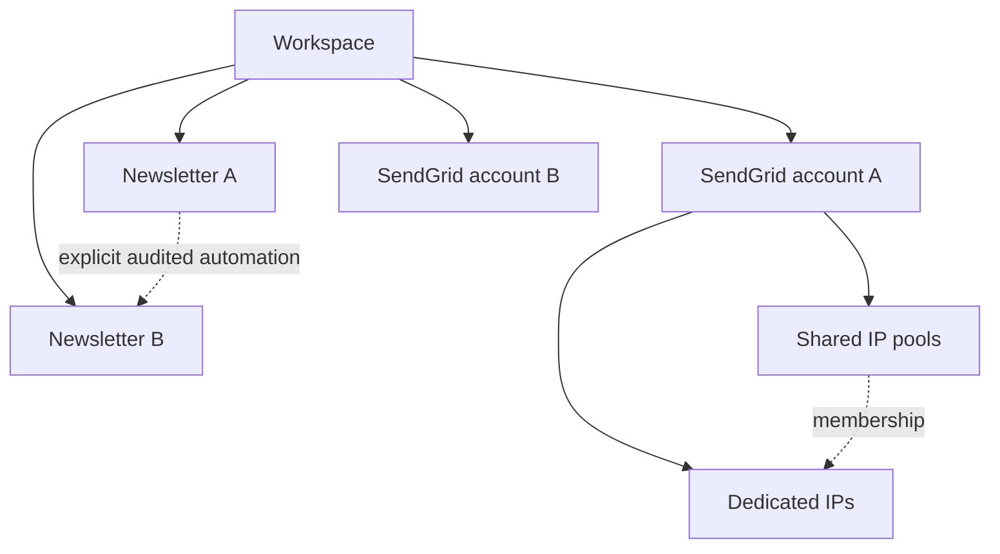

## Product structure

One installation contains workspaces, each with independent newsletters. Internally, a newsletter uses a native child workspace plus newsletter metadata. Subscriber profiles, consent, campaigns and history remain newsletter-local.

**ESP accounts** are independent workspace resources. Multiple SendGrid account
instances can coexist; newsletters require no account, IP or pool to exist.
IPs/pools belong to the relevant provider account, not a newsletter. Optional
newsletter defaults prefill sending choices and can be overridden for each send.

The workspace dashboard is `/dashboard/workspace`. Its left sidebar contains
Overview, Newsletters, ESP accounts, Dedicated IPs, Shared IPs, Subscribers, Reports
and Settings. Shared IPs are account-owned pools of dedicated IPs, not a provider-
shared service. The top-down map fits all assets; dragging changes layout only,
never newsletter ownership or sending choices.



A person's name, email, fields, consent, subscription state and engagement can differ between newsletters. Importing or updating A does not update B. Workspace suppression is a separate, deliberately shared mailbox-level control, not a shared profile.

The dashboard's **Newsletters** entry starts with a simple newsletter list: name, subscriber count, status and **Open**. **New newsletter** asks for a name; its sending ID is generated automatically, with optional customization before creation. Opening a newsletter enters its native audience/campaign/journey environment.

The top-right Workspace selector scopes every dashboard section and lists authorized workspaces, not their newsletters. Inside a newsletter it retains the containing workspace; **All newsletters** returns to the workspace list. Direct newsletter-only memberships remain accessible without granting parent access. ESP account details contain credentials, sender domains, signed webhooks, IPs/pools and observed activity. Settings retains tracking, automations, suppressions, activity and Advanced tools.

Search/export identities are `(newsletterId, userId)`, never `userId` alone. Contact/subscription counts and matched normalized mailboxes are separate measures; a matched mailbox is not a verified unique person. Every campaign and journey remains owned by its newsletter. Management workspaces cannot create campaigns or send.

Workspace memberships dynamically authorize newsletter access without copying child roles. Existing role levels and revocation continue to apply. Newsletter-only credentials cannot manage their parent or siblings. Shared-login development selection is stored in the signed session; do not disable its HTTP cookie warning or enable secure cookies without TLS.

## HTTP API and MCP

Browser operations use `/api/publications`; bearer operations use `/api/admin/publications`. Supply the authenticated management workspace's `workspaceId` in the documented body/query. A target newsletter uses `newsletterId`, not an unchecked replacement workspace ID. Responses use `{data: ...}` and never expose stored management/runtime keys. Historical `publisher` schema identifiers, API paths and configuration names remain unchanged; they are not product terminology.

The authenticated live OpenAPI document and operation catalog describe the current schemas. The stdio MCP bridge generates the same operations from them. A workspace-bound MCP process can also supply top-level `newsletterId` to a native product tool (contacts, ingestion, templates, broadcasts, journeys, etc.). Before execution the bridge verifies that the selected newsletter is a direct child of its configured workspace, then applies that scope consistently to headers/query/body. Workspace-management tools remain bound to the management workspace. No host, bearer key, arbitrary workspace or browser identity override is accepted. Revocation/ownership is checked on every call, not cached.

Example native contact query arguments from a workspace-bound MCP process:

```json
{"newsletterId":"NEWSLETTER_WORKSPACE_UUID","body":{"limit":25}}
```

Read-only keys can inspect registry/reporting and search contacts. Management-key/runtime-key administration, SendGrid provisioning and related credential/resource changes require all four independent grants: `read,write,destructive,sensitive`. Suppression deactivation is destructive. Provider callbacks, migrations and worker primitives are not machine tools. See [API and MCP access](/guide/mcp).

| Operation | Purpose |
| --- | --- |
| `POST /publisher` | Explicitly opt an authorized, campaign-free top-level workspace into newsletter management. |
| `GET /`, `POST /`, `PATCH /` | List, create, rename, activate or pause independent newsletters. Creation is resumable by workspace/slug. |
| `POST /adopt` | Adopt an already-owned child workspace; reject foreign roots. Select its existing email subscription group explicitly if ambiguous. No contacts are copied. |
| `GET /overview` | Combined publication-local contacts/subscriptions and matched-mailbox counts. |
| `POST /contacts/search`, `POST /contacts/operations` | Scoped search and explicit subscribe/unsubscribe operations. Cross-publication operations require composite targets; no implicit all-contact edit. |
| `GET /infrastructure` | Redacted accounts, connections, IPs, pools, memberships, bindings and defaults. |
| `PUT /infrastructure/accounts` | Create/edit independent ESP account instances and encrypted credentials. |
| `POST /infrastructure/accounts/inspect` | Read-only inspection of an account's existing provider resources. |
| `POST /infrastructure/connections/inspect` | Inspect the account-owned sending connection. |
| `POST /infrastructure/domains`, `POST /infrastructure/senders`, `POST /infrastructure/webhooks` | Reconcile authentication/DNS, verified sender identities and signed connection callbacks. Sender verification email is a separate explicit action. |
| `PUT /infrastructure/ips`, `PUT /infrastructure/pools` | Register already-owned physical IPs and independent logical pools. No purchases occur. |
| `PUT /infrastructure/pool-bindings`, `POST /infrastructure/pool-bindings/reconcile` | Bind/verify account-scoped provider pool names and reconcile provider pools behind the write gate. |
| `PUT /infrastructure/defaults`, `GET /sending-options` | Optional newsletter preferences and supported send-time choices. |
| `POST /infrastructure/ip-reassignment` | Explicit, separately gated provider assignment with `confirm:true`; never an automatic purchase. |
| `GET /suppressions`, `POST /suppressions/search`, `PUT /suppressions`, `POST /suppressions/deactivate` | List/search workspace mailbox blocks and explicitly deactivate them. Newsletter resubscription cannot clear these blocks. |
| `GET /automations`, `PUT /automations`, `DELETE /automations`, `GET /automations/actions` | Configure/retire audited cross-publication rules and inspect outcomes. Retirement retains history. |
| `GET /sends`, `GET /delivery-health` | Inspect durable attempts, uncertainty, native delivery observations and physical-IP budgets. |

Suppression, send and automation-action lists support bounded `limit`/`offset` pagination. Mailbox suppression searches use a POST body, not a mailbox address in a query-string URL.

## Explicit cross-publication automations

An enabled rule can match A's `DFEmailClicked` at a specified URL, find or create an independent B subscriber, apply only configured field mappings, subscribe and enter B's native welcome journey. Configuration is not ongoing synchronization. Existing destination fields are not overwritten unless the mapping explicitly requests it.

```json
{
  "workspaceId": "WORKSPACE_UUID",
  "name": "A link to B welcome",
  "sourceNewsletterId": "NEWSLETTER_A_UUID",
  "destinationNewsletterId": "NEWSLETTER_B_UUID",
  "enabled": true,
  "definition": {
    "source": {
      "eventType": "track",
      "event": "DFEmailClicked",
      "link": {"path": "properties.url", "equals": "https://publication-b.example/join"}
    },
    "destination": {
      "match": {"field": "email", "source": "traits", "path": "email"},
      "createIfMissing": true,
      "subscribe": true,
      "welcomeJourneyId": "B_WELCOME_JOURNEY_UUID",
      "fieldMappings": [{"source": "traits", "path": "firstName", "destination": "firstName"}]
    },
    "oncePerSubscriber": true
  }
}
```

Use the exact observed link URL; authored attribution tokens/query parameters may change it. Conditions support `equals`/`exists` against source traits or event paths. The destination welcome journey must be Running, event-entry, and compatible with the generated native entry event; custom-key journeys are rejected rather than silently restarted.

A deliberately configured matching rule can subscribe a newly created B subscriber and records the rule's authorization/provenance. It does not override an existing B unsubscribe. An explicit, evidenced consent rule is required to authorize resubscription; workspace suppression is never overridden. A click alone does not establish human engagement or universally valid legal consent: operators remain responsible for the offered opt-in and applicable requirements.

Durable source intent precedes native ingestion. The bounded worker verifies the exact native source exists before acting, records deterministic per-step IDs/progress and checks lineage to prevent cycles. Stable source-event deduplication and default once-per-source-subscriber behavior prevent repeated clicks or retries from creating duplicate subscriptions or restarting welcomes. Native PostgreSQL/ClickHouse projection is not a claim of exactly-once storage.

## ESP accounts and SendGrid infrastructure

Add accounts under **ESP accounts**, then configure credentials and use **Check
connection** for read-only inspection. Registration only writes local configuration:
it never creates a provider account/subuser, purchases an IP or sends email. Parent
and existing subuser identities are supported. Each instance owns its sending
credential and optional separate management credential; management credentials are
never runtime keys. Secret persistence requires a stable private 32-byte base64
`SECRET_KEY`. Protect it and backups; changing it requires re-encrypting credentials.

Domain authentication, signed-webhook setup, pool synchronization and physical IP
reassignment remain explicit, separately authorized actions. DNS records must
actually verify. Existing SendGrid keys cannot be retrieved: supply the restricted
key securely, without rotating or duplicating adopted resources. AI Stock News's
existing `aistocknews-ditto` identity must be adopted, never recreated.

The current managed-account adapter is SendGrid. Existing non-newsletter provider
paths remain supported; an unsupported provider override inside a managed
newsletter fails explicitly rather than bypassing durable sending controls.

Choose an account and **Automatic**, a **Shared IP pool**, or an eligible **Dedicated
IP via pool**. SendGrid selects pools, not arbitrary raw IPs; an individual IP is eligible
only through a verified singleton provider pool. Multi-IP/automatic selection
conservatively reserves every potential physical IP, not their summed capacity.
Aliases share a canonical physical budget. Draft/unverified aliases cannot change
another verified account's admission policy.

## Admission, queuing and uncertainty

Every opted-in newsletter email path—broadcast, journey, API and actual test email—uses central durable admission after native personalization and tracking preparation. Shared hourly/daily windows and configured warm-up stages are enforced by physical-IP reservations across newsletters and workers, counting To/CC/BCC copies. Newsletter or pool names are not separate capacity budgets. Tests are real email if submitted; workspace suppression and release gates still apply.

The initial result is `DFInternalMessageQueued`, not `DFInternalMessageSent`. A registered worker submits eligible mail and emits native MessageSent only after acceptance. Journey nodes wait for acceptance before advancing; broadcasts do not report completion while their queue is unsettled. Unknown provider acceptance requires review and never authorizes a blind resend. Paused/cancelled campaign state, subscription changes, erasure, expiry and workspace blocks are rechecked before submission. Accepted mail cannot be recalled by a local cancellation.

A persisted attempt pins its rendered payload, account/connection revisions and credential, sender, region, selection and potential IPs. Changing defaults does not retarget confirmed campaigns or queued attempts. A reported actual IP is separate from the selected pool; unknown stays unknown. Unknown acceptance never authorizes automatic provider failover. SendGrid acceptance is neither delivery nor human engagement. Limits govern API admission, not subsequent SMTP timing, and cannot cover traffic sent outside these controls.

## Suppression, callbacks and engagement

Ordinary unsubscribe stays newsletter-specific. Spam complaints block workspace-wide marketing; explicit workspace opt-outs/manual blocks are shared. Only genuinely permanent invalid-mailbox failures become workspace delivery blocks. Temporary failures, full-mailbox deferrals and policy/reputation rejection are not permanent invalid addresses.

Signed callbacks use `/api/public/webhooks/sendgrid/connections/{connectionId}`. Verification uses exact raw bytes, bounded timestamp replay checks and retained verification-key generations. Durable receipts correlate provider IDs with stored newsletter/send/recipient ownership; callback-supplied tenant/contact metadata is not authority. Duplicate or early callbacks are retained/reconciled rather than guessed. The existing legacy callback remains for non-opted-in workspaces.

Native per-send/contact observed opens/clicks, signed subscription links, current explicit RoninConv-compatible Liquid URL tokens/field/hash rendering, and owned open evidence remain intact. Literal URLs are not automatically rewritten. Opens/scanner clicks remain unqualified observations. Contact erasure removes encrypted send/source evidence and retains hash-only/opaque retry barriers; do not silently resurrect erased subscribers through late callbacks or automation replay.

Delivery health distinguishes acceptance, delivery, bounce, complaint and observed engagement. Account **Attempts (30d)** counts durable sends created in the window; delivery/bounce/complaint counts deduplicate correlated sends with observations occurring in that window, not cohort rates. Unavailable analytics stays unknown, not zero. Missing historical account/IP attribution is never inferred from today's default or ownership. Provider-wide history and provider account age are not fabricated.

## AI Stock News release preflight

Run the read-only preflight with deployment configuration injected privately:

```bash
yarn workspace backend-lib newsletter-cutover-preflight
```

It accepts `DATABASE_URL`, `NEWSLETTER_PUBLISHER_ID` when ambiguous, encrypted registry credentials or `SENDGRID_MANAGEMENT_API_KEY` / `SENDGRID_NEWSLETTER_API_KEY`, and optional `GOOGLE_ADMIN_ACCESS_TOKEN` / `RONIN_NEWSLETTER_ADMIN_GROUP_ID` for the existing administrative group's metadata. Never put credentials in CLI arguments, URLs, source, logs or prompts. Exit 0 means inspected prerequisites pass; 1 means findings; 2 means inspection incomplete. Local preview findings do not certify production.

Before releasing:

1. Inventory existing contacts/consent/suppression, provider resources/defaults, callbacks, campaigns, and running Temporal workflows read-only. Preserve all history and historical migrations.
2. Apply journal migrations through `0018_esp_accounts` using the normal release process. Historical file hashes remain unchanged; the runner strips historical file-edge transaction wrappers only during execution so fresh bootstrap and account cutover remain inside the migration transaction. Do not generate cleanup from retired provider schema differences.
3. Authorize the management/newsletter mapping and AI Stock News live-contact migration separately. Adopt existing resources; do not infer consent or merge profiles.
4. Configure public TLS/DNS/callbacks and secure management/runtime credentials. Verify the actual subuser/pool/IP association before routing traffic.
5. Keep `allowProviderWrites`, `allowIpReassignment` and `allowRealSends` closed until their respective releases are approved. An explicit API flag is an authorization control, not proof that an operational review happened. No automatic IP purchases are implemented.
6. Run the registered workers/global cron for durable callback projection, automation execution, queued sending and existing tracking cleanup. Drain or explicitly reconfigure in-flight legacy workflows before opting their workspace into newsletter sending.
7. Approve a real controlled send separately. Review volume, delivery results, complaint/bounce behavior and shared reputation before increasing capacity or separating streams. No universal IP capacity or warm-up schedule is assumed.
