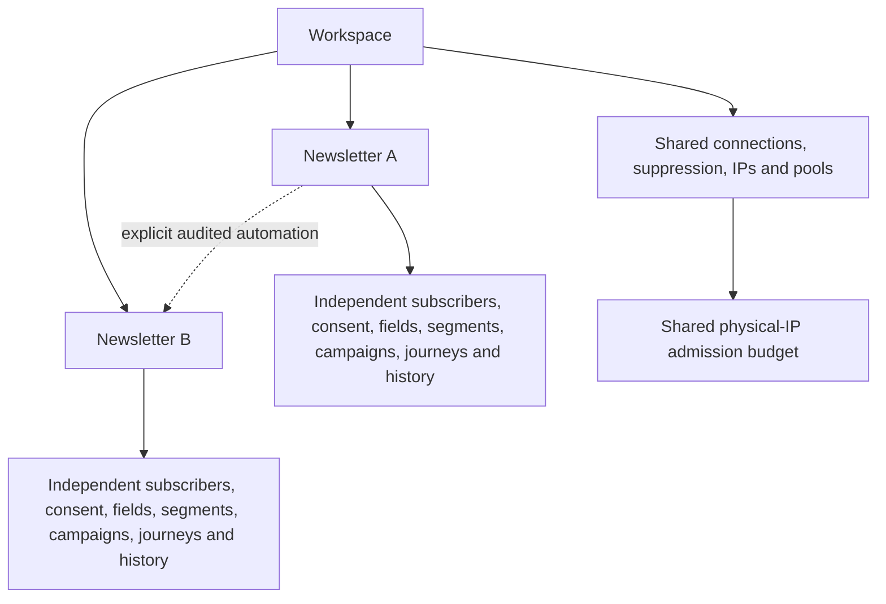

## Product structure

One installation contains workspaces, each with independent newsletters. Internally, a newsletter uses a native child workspace plus newsletter metadata. Subscriber profiles, consent, campaigns and history remain newsletter-local.

The approved next design makes **ESP accounts** a separate workspace collection,
with multiple instances of each provider type. Newsletters require no ESP/IP/pool
association to exist. Sending chooses an ESP account and its supported IP/pool or
explicit automatic option; optional newsletter defaults only prefill that choice.
IPs and pools stay under ESP accounts, not newsletters. See the
[approved implementation plan](https://github.com/roninpublishing/dittofeed/blob/main/FORK_PLAN.md#approved-next-esp-accounts-and-send-time-selection).
This is planned work, not a claim that multi-account sending is implemented.

The workspace UI build is scoped to `/dashboard/workspace`, with left-sidebar
Overview, Newsletters, ESP accounts, IPs, IP pools, Subscribers, Reports and Settings.
ESP account details and workspace-wide IP/pool inventories share the same account-
owned records. These are planned screens; the route rename initially preserves
the current views under `/dashboard/workspace?view=...`. Backend API names stay
unchanged. The map navigates/configures resources without assigning IPs to newsletters.



A person's name, email, fields, consent, subscription state and engagement can differ between newsletters. Importing or updating A does not update B. Workspace suppression is a separate, deliberately shared mailbox-level control, not a shared profile.

The dashboard's **Newsletters** entry starts with a simple newsletter list: name, subscriber count, status and **Open**. **New newsletter** asks for a name; its sending ID is generated automatically, with optional customization before creation. Opening a newsletter enters its native audience/campaign/journey environment.

Workspace navigation contains **Newsletters**, **Subscribers**, **Reports** and **Workspace settings**. The top-right Workspace selector lists authorized workspaces, not their newsletters. Inside a newsletter, it retains the containing workspace and provides **All newsletters** to return. Newsletter-only memberships remain separately accessible without granting parent access. Workspace settings uses focused sending, domain and IP workflows; raw administration lives in **Advanced**.

Search/export identities are `(newsletterId, userId)`, never `userId` alone. Contact/subscription counts and matched normalized mailboxes are separate measures; a matched mailbox is not a verified unique person. Every campaign and journey remains owned by its newsletter. Management workspaces cannot create campaigns or send.

Workspace memberships dynamically authorize newsletter access without copying child roles. Existing role levels and revocation continue to apply. Newsletter-only credentials cannot manage their parent or siblings. Shared-login development selection is stored in the signed session; do not disable its HTTP cookie warning or enable secure cookies without TLS.

## HTTP API and MCP

Browser operations use `/api/publications`; bearer operations use `/api/admin/publications`. Supply the authenticated management workspace's `workspaceId` in the documented body/query. A target newsletter uses `newsletterId`, not an unchecked replacement workspace ID. Responses use `{data: ...}` and never expose stored management/runtime keys. Historical `publisher` schema identifiers, API paths and configuration names remain unchanged; they are not product terminology.

The authenticated live OpenAPI document and operation catalog describe the current schemas. The stdio MCP bridge generates the same operations from them. A workspace-bound MCP process can also supply top-level `newsletterId` to a native product tool (contacts, ingestion, templates, broadcasts, journeys, etc.). Before execution the bridge verifies that the selected newsletter is a direct child of its configured workspace, then applies that scope consistently to headers/query/body. Workspace-management tools remain bound to the management workspace. No host, bearer key, arbitrary workspace or browser identity override is accepted. Revocation/ownership is checked on every call, not cached.

Example native contact query arguments from a workspace-bound MCP process:

```json
{"newsletterId":"NEWSLETTER_WORKSPACE_UUID","body":{"limit":25}}
```

Read-only keys can inspect registry/reporting and search contacts. Management-key/runtime-key administration, SendGrid provisioning and related credential/resource changes require all four independent grants: `read,write,destructive,sensitive`. Suppression deactivation is destructive. Provider callbacks, migrations and worker primitives are not machine tools. See [API and MCP access](/guide/mcp).

| Operation | Purpose |
| --- | --- |
| `POST /publisher` | Explicitly opt an authorized, campaign-free top-level workspace into newsletter management. |
| `GET /`, `POST /`, `PATCH /` | List, create, rename, activate or pause independent newsletters. Creation is resumable by workspace/slug. |
| `POST /adopt` | Adopt an already-owned child workspace; reject foreign roots. Select its existing email subscription group explicitly if ambiguous. No contacts are copied. |
| `GET /overview` | Combined publication-local contacts/subscriptions and matched-mailbox counts. |
| `POST /contacts/search`, `POST /contacts/operations` | Scoped search and explicit subscribe/unsubscribe operations. Cross-publication operations require composite targets; no implicit all-contact edit. |
| `GET /infrastructure` | Redacted accounts, connections, IPs, pools, bindings, routes and gates. |
| `PUT /infrastructure/account` | Encrypt management credentials and configure region, callback origin and explicit release gates. |
| `POST /infrastructure/inspect` | Read-only existing-account/subuser inventory, defaulting to `aistocknews-ditto`. |
| `PUT /infrastructure/connections` | Register/adopt a newsletter connection and existing restricted runtime key. |
| `POST /infrastructure/connections/inspect`, `POST /infrastructure/connections/provision` | Inspect or resume reconciliation/provisioning without duplicating existing resources. |
| `POST /infrastructure/domains`, `POST /infrastructure/senders`, `POST /infrastructure/webhooks` | Reconcile authentication/DNS, verified sender identities and signed connection callbacks. Sender verification email is a separate explicit action. |
| `PUT /infrastructure/ips`, `PUT /infrastructure/pools` | Register already-owned physical IPs and independent logical pools. No purchases occur. |
| `PUT /infrastructure/pool-bindings`, `POST /infrastructure/pool-bindings/reconcile` | Bind/verify account-scoped provider pool names and reconcile provider pools behind the write gate. |
| `PUT /infrastructure/routes` | Change the connection/pool for future sends without rebuilding campaigns. |
| `POST /infrastructure/ip-reassignment` | Explicit, separately gated provider assignment with `confirm:true`; never an automatic purchase. |
| `GET /suppressions`, `POST /suppressions/search`, `PUT /suppressions`, `POST /suppressions/deactivate` | List/search workspace mailbox blocks and explicitly deactivate them. Newsletter resubscription cannot clear these blocks. |
| `GET /automations`, `PUT /automations`, `DELETE /automations`, `GET /automations/actions` | Configure/retire audited cross-publication rules and inspect outcomes. Retirement retains history. |
| `GET /sends`, `GET /delivery-health` | Inspect durable attempts, uncertainty, native delivery observations and physical-IP budgets. |

Suppression, send and automation-action lists support bounded `limit`/`offset` pagination. Mailbox suppression searches use a POST body, not a mailbox address in a query-string URL.

## Explicit cross-publication automations

An enabled rule can match A's `DFEmailClicked` at a specified URL, find or create an independent B subscriber, apply only configured field mappings, subscribe and enter B's native welcome journey. Configuration is not ongoing synchronization. Existing destination fields are not overwritten unless the mapping explicitly requests it.

```json
{
  "workspaceId": "WORKSPACE_UUID",
  "name": "A link to B welcome",
  "sourceNewsletterId": "NEWSLETTER_A_UUID",
  "destinationNewsletterId": "NEWSLETTER_B_UUID",
  "enabled": true,
  "definition": {
    "source": {
      "eventType": "track",
      "event": "DFEmailClicked",
      "link": {"path": "properties.url", "equals": "https://publication-b.example/join"}
    },
    "destination": {
      "match": {"field": "email", "source": "traits", "path": "email"},
      "createIfMissing": true,
      "subscribe": true,
      "welcomeJourneyId": "B_WELCOME_JOURNEY_UUID",
      "fieldMappings": [{"source": "traits", "path": "firstName", "destination": "firstName"}]
    },
    "oncePerSubscriber": true
  }
}
```

Use the exact observed link URL; authored attribution tokens/query parameters may change it. Conditions support `equals`/`exists` against source traits or event paths. The destination welcome journey must be Running, event-entry, and compatible with the generated native entry event; custom-key journeys are rejected rather than silently restarted.

A deliberately configured matching rule can subscribe a newly created B subscriber and records the rule's authorization/provenance. It does not override an existing B unsubscribe. An explicit, evidenced consent rule is required to authorize resubscription; workspace suppression is never overridden. A click alone does not establish human engagement or universally valid legal consent: operators remain responsible for the offered opt-in and applicable requirements.

Durable source intent precedes native ingestion. The bounded worker verifies the exact native source exists before acting, records deterministic per-step IDs/progress and checks lineage to prevent cycles. Stable source-event deduplication and default once-per-source-subscriber behavior prevent repeated clicks or retries from creating duplicate subscriptions or restarting welcomes. Native PostgreSQL/ClickHouse projection is not a claim of exactly-once storage.

## Current SendGrid implementation — migration baseline

Each newsletter derives one subuser username `{slug}-ditto` and administrative email `{slug}@roninpublishing.com`. A separate restricted `mail.send` key is used at runtime. Parent management credentials are never runtime credentials. Secret persistence requires an explicit stable private 32-byte base64 `SECRET_KEY`; protect it and backups. Changing it without re-encrypting stored credentials makes them unreadable.

Provisioning records completed steps and inspects existing provider resources before creating missing ones. Domain authentication requires publishing returned DNS records and verifying status. Existing keys cannot be retrieved from SendGrid; supply the existing restricted key securely for adoption rather than automatically rotating or duplicating it. Sender/domain/webhook readiness and pool membership must be verified before sending. The callback origin must be public HTTPS, not the local dashboard.

AI Stock News is adopt-first: inspect `aistocknews-ditto`, its restricted key metadata, authenticated domains and administrative group; do not recreate them. Missing expected resources fail explicitly. Subsequent deliberate management changes still require the normal release gates. The existing administrative group is externally owned; the preflight can inspect metadata using optional Directory credentials but never creates it.

Start with one already-owned dedicated IP shared by newsletter subusers. Pool bindings are account-specific; logical pools and physical IPs are independent of newsletter identity. Deterministic single-IP provider pools are required for strict per-IP admission. Omitting a provider pool could allow SendGrid to use any assigned IP; this implementation must reject invalid routing rather than fall back. Shared IPs share reputation; independent contact records do not guarantee publications appear unrelated publicly.

The current single-IP route/admission requirements above must be migrated before
multi-IP or provider-managed selection is supported. They are not permanent
newsletter-to-IP assignments in the target product. The new overview must not
draw those binding edges. Confirmed selections belong to individual scheduled
sends/attempts; changing a newsletter default must not rewrite their history.

## Admission, queuing and uncertainty

Every opted-in newsletter email path—broadcast, journey, API and actual test email—uses central durable admission after native personalization and tracking preparation. Shared hourly/daily windows and configured warm-up stages are enforced by physical-IP reservations across newsletters and workers, counting To/CC/BCC copies. Newsletter or pool names are not separate capacity budgets. Tests are real email if submitted; workspace suppression and release gates still apply.

The initial result is `DFInternalMessageQueued`, not `DFInternalMessageSent`. A registered worker submits eligible mail and emits native MessageSent only after acceptance. Journey nodes wait for acceptance before advancing; broadcasts do not report completion while their queue is unsettled. Unknown provider acceptance requires review and never authorizes a blind resend. Paused/cancelled campaign state, subscription changes, erasure, expiry and workspace blocks are rechecked before submission. Accepted mail cannot be recalled by a local cancellation.

A persisted attempt pins its rendered payload, connection revision/credential, region and intended route. Route changes apply to new attempts, not the existing payload. SendGrid acceptance means neither delivery nor human engagement. Our reservation limits govern API admission, not SendGrid's subsequent SMTP timing. Traffic outside Ditto can bypass them: do not claim a hard aggregate limit unless all traffic through the IP enters these controls. Provider warm-up overflow/deferral behavior is a separate control.

## Suppression, callbacks and engagement

Ordinary unsubscribe stays newsletter-specific. Spam complaints block workspace-wide marketing; explicit workspace opt-outs/manual blocks are shared. Only genuinely permanent invalid-mailbox failures become workspace delivery blocks. Temporary failures, full-mailbox deferrals and policy/reputation rejection are not permanent invalid addresses.

Signed callbacks use `/api/public/webhooks/sendgrid/connections/{connectionId}`. Verification uses exact raw bytes, bounded timestamp replay checks and retained verification-key generations. Durable receipts correlate provider IDs with stored newsletter/send/recipient ownership; callback-supplied tenant/contact metadata is not authority. Duplicate or early callbacks are retained/reconciled rather than guessed. The existing legacy callback remains for non-opted-in workspaces.

Native per-send/contact observed opens/clicks, signed subscription links, current explicit RoninConv-compatible Liquid URL tokens/field/hash rendering, and owned open evidence remain intact. Literal URLs are not automatically rewritten. Opens/scanner clicks remain unqualified observations. Contact erasure removes encrypted send/source evidence and retains hash-only/opaque retry barriers; do not silently resurrect erased subscribers through late callbacks or automation replay.

Delivery health distinguishes acceptance, delivery, bounce, complaint and observed engagement. Native event counters deduplicate stable event/time identities. Missing historical IP attribution stays unassigned; today's route is never applied retroactively. The displayed 30-day occurrence window is not a delivery-cohort success rate.

## AI Stock News release preflight

Run the read-only preflight with deployment configuration injected privately:

```bash
yarn workspace backend-lib newsletter-cutover-preflight
```

It accepts `DATABASE_URL`, `NEWSLETTER_PUBLISHER_ID` when ambiguous, encrypted registry credentials or `SENDGRID_MANAGEMENT_API_KEY` / `SENDGRID_NEWSLETTER_API_KEY`, and optional `GOOGLE_ADMIN_ACCESS_TOKEN` / `RONIN_NEWSLETTER_ADMIN_GROUP_ID` for the existing administrative group's metadata. Never put credentials in CLI arguments, URLs, source, logs or prompts. Exit 0 means inspected prerequisites pass; 1 means findings; 2 means inspection incomplete. Local preview findings do not certify production.

Before releasing:

1. Inventory existing contacts/consent/suppression, provider resources/defaults, callbacks, campaigns, and running Temporal workflows read-only. Preserve all history and historical migrations.
2. Apply additive migration `0016_ronin_newsletters` through the normal release process. Do not generate destructive cleanup from retired provider schema differences.
3. Authorize the management/newsletter mapping and AI Stock News live-contact migration separately. Adopt existing resources; do not infer consent or merge profiles.
4. Configure public TLS/DNS/callbacks and secure management/runtime credentials. Verify the actual subuser/pool/IP association before routing traffic.
5. Keep `allowProviderWrites`, `allowIpReassignment` and `allowRealSends` closed until their respective releases are approved. An explicit API flag is an authorization control, not proof that an operational review happened. No automatic IP purchases are implemented.
6. Run the registered workers/global cron for durable callback projection, automation execution, queued sending and existing tracking cleanup. Drain or explicitly reconfigure in-flight legacy workflows before opting their workspace into newsletter sending.
7. Approve a real controlled send separately. Review volume, delivery results, complaint/bounce behavior and shared reputation before increasing capacity or separating streams. No universal IP capacity or warm-up schedule is assumed.
